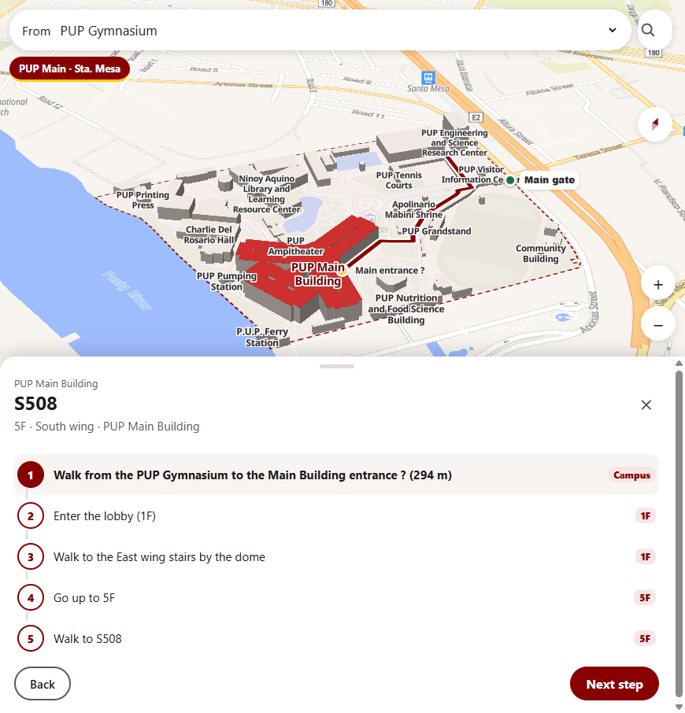
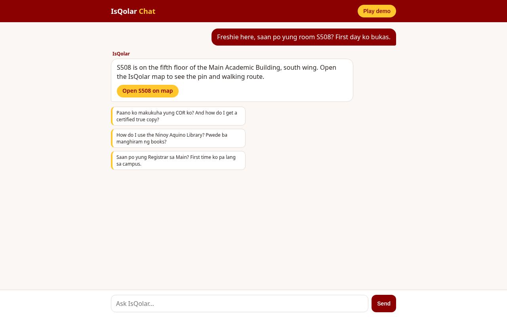

<p align="center">
  
</p>

<h1 align="center">IsQolar</h1>

<p align="center"><b>Every Iskolar, in the right line.</b><br>
A live queue, campus map and help desk for PUP freshman enrollment day, all in one phone browser tab.</p>

<p align="center">
  <a href="https://isqolar.onrender.com"><b>Live demo: isqolar.onrender.com</b></a>
</p>

<p align="center">
  
  
  
  
  
</p>

> **1st Place, ICS x IBM Bobathon 2026.** Built by a team of five PUP students in a two-day hackathon.

## The problem

Every enrollment day, 200 to 300 PUP Manila freshmen line up at course stalls with no idea where they stand. Nobody knows how long the wait is, whether it is safe to step away for food, or which building their first class is in. So everyone stands in line, guesses, and waits.

IsQolar does not add interviewers or make the office faster. It removes the guessing and the wasted waiting.

## What it does

| Feature | What it gives you |
|---|---|
| **Per-course stall tickets** | Each freshman checks in and gets a ticket for their course stall, on their phone or printed with a QR code. |
| **Live board** | A TV-ready board shows every stall's queue so the whole room knows who is up next. |
| **Staff "Call next"** | Stall staff call the next student, mark them done, skip, look up by permit number, and undo a wrong tap. The board and phones update within seconds. |
| **Campus map** | A 3D MapLibre map of PUP Sta. Mesa with step-by-step walking directions from campus landmarks to the exact room and floor (for example, Gym to S508 on the 5th floor). |
| **FAQ chatbot** | Ask in English or Taglish ("saan po yung S508?") and get an answer with a button that opens the room on the map. |
| **LAN or online** | Runs on one laptop over the venue Wi-Fi with no internet, or online on Render for anyone with a link. Same code either way. |

<p align="center">
  
  &nbsp;
  
</p>

## Who it is for

- **Freshmen:** see your place at your stall, an estimated wait, and a checklist that ends with "You're fully enrolled."
- **Stall staff and interviewers:** call the next student, mark them done, look up by permit number, and undo mistakes.
- **Coordinators:** see which stalls are clogged and the average wait per stall.

## Tech stack

- **Runtime:** Node 20, Express 5, TypeScript (strict), run with tsx
- **Front end:** plain HTML, CSS and JavaScript pages that poll the server every 2 seconds
- **Map:** MapLibre GL with hand-traced floor plans and a room routing graph
- **Chat:** Groq chat completions, grounded on a curated FAQ and the room list (optional, off unless a key is set)
- **Quality:** Node test runner, ESLint, `tsc --noEmit`, and a map data checker, all run by GitHub Actions CI on every PR
- **Deploy:** Render (free web service) with a health check and a keep-awake workflow

Design decisions are written up as short ADRs in [docs/decisions/](docs/decisions/), and the data flow is in [docs/architecture.md](docs/architecture.md).

## Quick start

**Requirements:** Node 20 and npm.

```bash
npm install
npm start          # http://localhost:3000
```

Other devices on the same Wi-Fi can open `http://<laptop-ip>:3000`. `GET /health` returns `{"ok":true}`.

Load a simulated enrollment morning (every seeded ticket is labeled **simulated**):

```bash
npm run seed
```

Run the venue hub with state saved to disk:

```bash
npm run hub
```

Turn on the chatbot by setting `GROQ_API_KEY` in your environment (and optionally `GROQ_MODEL`). Without a key, the chat endpoint answers "not configured" and everything else works.

Run every check before opening a PR:

```bash
npm run check      # typecheck, lint, tests, map data check
```

## Enrollment stations (in order)

1. Check-in
2. Document check
3. Validation
4. Main waiting line
5. Course stall (grouped by department, 1 or 2 interviewers, second document check)
6. You're fully enrolled

## Scope and limits

- Built for one enrollment day of 200 to 300 freshmen.
- No native app. Students use their phone browser or a printed ticket.
- First-year students only. Continuing students, transferees and graduate students are out of scope.
- Does not connect to PUP's enrollment system (SIS) and does not handle payments.
- The free Render instance sleeps when idle. Open the live demo a minute before showing it.

## Team

Built for the ICS x IBM Bobathon 2026 by:

| Name | Role |
|---|---|
| Troy | Project manager, full stack: API contract, merges, Render deploy |
| Donita | Full stack: venue hub, offline persistence, design system |
| Ayen | Product manager, front end: student phone flow, demo script |
| Viv | Front end: TV board, admin desktop |
| Justin | Back end: simulated morning, poll client, printable QR ticket, guardian API |

IBM Bob was our AI coding assistant during development. See [AGENTS.md](AGENTS.md) and [.bob/rules/](.bob/rules/).

## License

[MIT](LICENSE). Copyright (c) 2026 IsQolar team.
