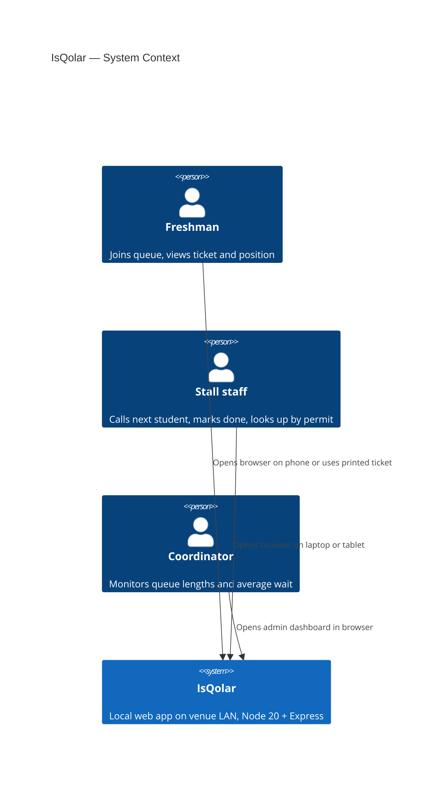
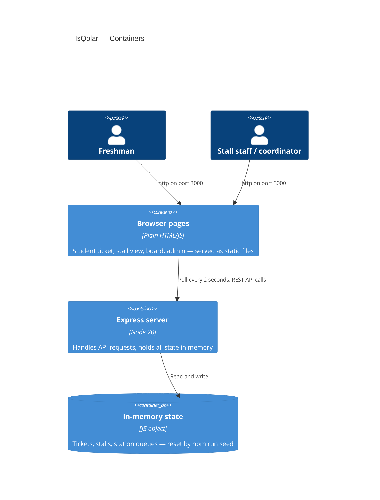

# Architecture

IsQolar is a Node 20 + Express server that serves plain HTML/JS pages.
It runs on one laptop (localhost) or a venue LAN.
There is no build step and no framework.

The shared data types and endpoint shapes are in [src/contract.ts](../src/contract.ts).

---

## C4 context diagram

---

## C4 containers diagram

---

## Data flow: ticket to stall to board

1. A staff member at check-in calls `POST /api/tickets` with the student's name and course. The server creates a `Ticket` at station `checkin` and returns it with a short printable code.
2. The student (or staff) shows the ticket code at each station. Staff call the matching endpoint to advance the ticket through stations: `checkin` → `docs` → `validation` → `main` → `stall` → `enrolled`.
3. At the `stall` station, the ticket is assigned to a specific course stall. The stall staff use `POST /api/stalls/:stall/next` to call the next ticket. The ticket status moves from `waiting` to `called`.
4. Staff call `POST /api/tickets/:id/done` to mark the current station done and advance the ticket.
5. `POST /api/tickets/:id/undo` reverts the last move (staff only).
6. The stall board page calls `GET /api/stalls` every 2 seconds and re-renders the counts.
7. The student ticket page calls `GET /api/tickets/:id` every 2 seconds and shows updated position and estimated wait.

---

## Processes

| Process | How to start |
|---|---|
| Server | `npm start` — listens on port 3000 |
| Seed | `npm run seed` — resets state, loads simulated morning, labels every seeded ticket as simulated |

---

## Poll interval

Pages poll every 2 seconds. There is no WebSocket or server-sent event connection.
See [docs/decisions/002-polling-over-websockets.md](decisions/002-polling-over-websockets.md).

---

## State

All state lives in memory on the server process.
Restarting the server or running `npm run seed` resets it.
There is no database and no file persistence.

---

## Estimated wait

The ticket page shows an estimated wait in whole minutes, rounded up.
It is calculated as: queue position multiplied by the average service time of the last 10 tickets completed at that stall.
If fewer than 10 tickets have been completed at a stall, the default is 3 minutes per ticket.

---

## Stations (in order)

| Value | Name |
|---|---|
| `checkin` | Check-in |
| `docs` | Document check |
| `validation` | Validation |
| `main` | Main waiting line |
| `stall` | Course stall |
| `enrolled` | You're fully enrolled |

Station values are part of the contract. See [src/contract.ts](../src/contract.ts).
