# Delegation

This is the run list for the night of Oct 15 and the morning of Oct 16. Base is main after PR 12 (docs: one product, Room TBA as 2D floor plans). Branch for this doc: troy/delegation-v2.

Clocks: tonight each person pushes a PR before sleeping. Oct 16: 11:00 AM full dry run, 12:30 PM code freeze (also the Room TBA cut), 2:00 PM submit.

The team is still in planning. No teammate feature PR is open. That is not a delay.

Queue owners stay as in the 4:19 PM note and docs/plan.md. RT owners that differ are listed under conflicts. Paste one Bob prompt per task. One task per PR.

## Already on main

- T1b, F0, T3, T2 merged. GET /health exists in src/server.ts and returns {"ok":true}. render.yaml has healthCheckPath /health and SEED=1. The Render Blueprint is not connected. Public /health is still 404. Seed is 5 tickets and 3 stalls (BSCS-1, BSIT-1, BSEE-1). public/map.html, public/admin.html, and public/guardian.html do not exist. data/floors.json does not exist.

## Conflicts to know

- docs/plan.md uses these same clocks: tonight, 11:00 dry run, 12:30 freeze, 2:00 submit. R1 and K1 are not start-now tasks. K2 is not the freeze.
- D3 is tonight after D1. POST /api/tickets/:id/undo already exists. Lookup matches the printed code on GET /api/stalls/:stall/queue.
- J1 target is about 40 tickets. src/store.ts and docs/product.md still have 5.
- RT1 owner is Troy, taken from Viv (it had been Viv, not Donita). RT2 owner is Troy, not Justin. RT6 owner is Ayen, not Justin. Reason: those files do not touch that person's queue files, and Justin and Donita already own the staff, seed, and ticket work.
- RT3, RT4, RT5, RT7, and RT8 start tomorrow morning. plan-room-tba.md originally marked RT1 through RT8 as tonight. They wait on earlier PRs.
- RT8 also waits on A4, because the enrolled screen is A4, which plan.md schedules tomorrow.
- Only L2 may edit src/contract.ts. G1 and H2 wait for L2.
- O2 is the public URL in README.md. J3 owns the printed ticket.
- AdminSummary.byStation is the only admin aggregate in the contract. V2 derives the slowest stall from GET /api/stalls queueLength.
- GuardianStatus exists. GET /api/guardian/:code does not.
- UP1 is the health pinger. The app must not make the outbound call. A scheduled GitHub Actions GET of the public /health is the pinger, and only after T4 has a real URL.
- src/server.ts serves public/ only. RT3 may add a static mount for data/ so the map can fetch JSON. That mount must not change ticket or stall routes.
- Library 3F: docs/floorplans/library-3F.png exists and docs/floorplans/rooms.json has 30 rows with source library-3F.png, building Library (NALRC), floor 3F. catalog.md now lists that image as present. It is not a tonight floor.

## Load after this split

| Person | Tonight | Tomorrow AM |
| --- | --- | --- |
| Troy | T4, RT1, RT2 | L2, O1, O2, UP1, RT7, X2, RT12, S4, and R2 at 11:00 |
| Donita | H0, D1, D3 | D2, H1, H2, W1, X1, S5 |
| Justin | J1, P0, J2 | RT5, G1, J3 |
| Ayen | A1, RT6 | A4, A3, RT8, A2, A5, S1 |
| Viv | V1 | RT3, RT4, V3, V2, S2 |

Viv's tomorrow order is RT3, RT4, V3, V2. Justin's long task tomorrow is RT5 (27 + 39 + 76 labels).

# Troy

Already merged, do not redo: T1b (seed fix PR), F0 (public/board.html, public/staff.html, public/phone.html, public/poll.js shells), T3 (Store interface in src/store.ts), and T2 (ADR 005 and ADR 006). Troy also merges other people's PRs, and there is no separate branch for merges.

## Tonight

### T4. Connect Render
- Goal: Connect the Render Blueprint and deploy main so the public /health is not 404.
- Files: render.yaml (already has healthCheckPath /health, SEED=1, autoDeploy true, service name isqolar). README.md only after a real URL exists.
- Depends on: T3, which is done.
- Done when: The deployed URL's GET /health returns {"ok":true}. Local src/server.ts already has GET /health. No doc contains a live onrender.com URL. Do not invent one.
- Branch: `troy/t4-render`

```
Task T4. Connect Render.

Goal: Connect the Render Blueprint and deploy main so the public /health is not 404.

Files: render.yaml already has healthCheckPath /health, SEED=1, autoDeploy true, and the service name isqolar. Touch README.md only after a real URL exists.

Depends on: T3, which is done.

Branch from a fresh main: troy/t4-render.

Read docs/delegation.md for this task id.

Troy connects the Blueprint in the Render dashboard. Do not call the Render API. Do not guess a hostname. Do not invent rooms, aliases, student names, or a Render hostname.

Do not edit src/contract.ts. Do not change queue logic except where this task says so.

Local src/server.ts already has GET /health. If the live URL is not known, stop after checking render.yaml. Do not open a pull request that only guesses a URL. No doc contains a live onrender.com URL. Do not invent one.

Done when: The deployed URL's GET /health returns {"ok":true}.

When the done-when line is true, run npm run check. Open a pull request into main. Stop after opening the PR and report the PR link. Do not merge. Troy reviews and merges.
```

### RT1. Clean floor images
- Goal: public/maps/ has the three tonight floors.
- Files: docs/floorplans/IBM_7739.JPG, docs/floorplans/IBM_7741.JPG, docs/floorplans/IBM_7742.JPG, public/maps/, scripts/clean-floorplan.py, docs/floorplans/cleaning.md
- Depends on: none
- Done when: public/maps/ has a cleaned lobby image from IBM_7739, a straightened and cropped Main 4F image from IBM_7741, and a Main 5F image from IBM_7742.
- Branch: `troy/rt1-clean-images`
- Owner: Troy, taken from Viv.

```
Branch from a fresh main using `troy/rt1-clean-images`.
Read docs/delegation.md for RT1.
public/maps/ does not exist yet. Copy from docs/floorplans/IBM_7739.JPG, IBM_7741.JPG, and IBM_7742.JPG into public/maps/. Deliver a cleaned lobby image from IBM_7739, a straightened and cropped Main 4F image from IBM_7741, and a Main 5F image from IBM_7742. Do not add IBM_7721, IBM_7734, IBM_7740, IBM_7726, or library-3F.png. Do not flip IBM_7741. Do not invent coordinates.
Do not edit src/contract.ts.
Run npm run check.
Open a pull request into main.
Troy took this task from Viv.
Stop after opening the PR and report the PR link. Do not merge. Troy reviews and merges.
```

### RT2. Write the floors file
- Goal: data/floors.json lists the three tonight floors.
- Files: data/floors.json (does not exist yet). Image paths point at public/maps/ files from RT1. Copy building and floor text from docs/floorplans/rooms.json.
- Depends on: RT1
- Done when: The file has three rows (IBM_7739 lobby, IBM_7741 Main 4F, IBM_7742 Main 5F) with id, building, floor, label, image, approximate. The lobby row has approximate true. No IBM_7721, no library-3F.png, no IBM_7734.
- Branch: `troy/rt2-floors-json`

```
Task RT2. Write the floors file.

Goal: data/floors.json lists the three tonight floors.

Files: data/floors.json (does not exist yet). Image paths point at public/maps/ files from RT1. Copy building and floor text from docs/floorplans/rooms.json.

Depends on: RT1.

Branch from a fresh main: troy/rt2-floors-json.

Read docs/delegation.md for this task id.

Read docs/plan-room-tba.md RT2 and docs/map-data-guide.md. Do not invent a floor. Do not invent rooms, aliases, student names, or a Render hostname.

Do not edit src/contract.ts. Do not change queue logic except where this task says so.

Done when: The file has three rows (IBM_7739 lobby, IBM_7741 Main 4F, IBM_7742 Main 5F) with id, building, floor, label, image, approximate. The lobby row has approximate true. No IBM_7721, no library-3F.png, no IBM_7734.

When the done-when line is true, run npm run check. Open a pull request into main. Stop after opening the PR and report the PR link. Do not merge. Troy reviews and merges.
```

## Tomorrow AM

### L2. Contract additions
- Goal: Freeze the guardian route, source, and staff-queue sync fields into the contract.
- Files: src/contract.ts only. GuardianStatus already exists and is marked not implemented. There is no GET /api/guardian/:code comment yet. Ticket has no source field.
- Depends on: none. Do this first tomorrow. The file has been frozen since 11:15 on Oct 15. Only Troy may edit it. Tell the team in the PR.
- Done when: The contract documents GET /api/guardian/:code returning the existing GuardianStatus, a source field whose values are hub or online, and the sync fields this PR names for the offline staff queue. No other contract edits.
- Branch: `troy/l2-contract`

```
Task L2. Contract additions.

Goal: Freeze the guardian route, source, and staff-queue sync fields into the contract.

Files: src/contract.ts only. GuardianStatus already exists and is marked not implemented. There is no GET /api/guardian/:code comment yet. Ticket has no source field.

Depends on: none. Do this first tomorrow. The file has been frozen since 11:15 on Oct 15. Only Troy may edit it. Tell the team in the PR.

Branch from a fresh main: troy/l2-contract.

Read docs/delegation.md for this task id.

You may edit src/contract.ts. Do not change src/server.ts or queue behavior. Do not invent rooms, aliases, student names, or a Render hostname.

Done when: The contract documents GET /api/guardian/:code returning the existing GuardianStatus, a source field whose values are hub or online, and the sync fields this PR names for the offline staff queue. No other contract edits.

When the done-when line is true, run npm run check. Open a pull request into main. Stop after opening the PR and report the PR link. Do not merge. Troy reviews and merges.
```

### O1. Wake before demos
- Goal: The free Render instance is woken before a demo.
- Files: README.md, render.yaml (health and SEED=1 are already set). ADR 005 says the free instance sleeps after about 15 minutes.
- Depends on: T4
- Done when: README says to open the public URL before a demo, and that URL is the one T4 recorded. No new service. The Express app still makes no outbound call.
- Branch: `troy/o1-wake-note`

```
Task O1. Wake before demos.

Goal: The free Render instance is woken before a demo.

Files: README.md, render.yaml (health and SEED=1 are already set). ADR 005 says the free instance sleeps after about 15 minutes.

Depends on: T4.

Branch from a fresh main: troy/o1-wake-note.

Read docs/delegation.md for this task id.

Do not invent rooms, aliases, student names, or a Render hostname. Use only the public URL T4 recorded.

Do not edit src/contract.ts. Do not change queue logic except where this task says so.

Done when: README says to open the public URL before a demo, and that URL is the one T4 recorded. No new service. The Express app still makes no outbound call.

When the done-when line is true, run npm run check. Open a pull request into main. Stop after opening the PR and report the PR link. Do not merge. Troy reviews and merges.
```

### O2. Public URL in README
- Goal: The Render URL from T4 is written in README. autoDeploy is already true in render.yaml.
- Files: README.md only. Do not edit the printed ticket (that is J3).
- Depends on: O1
- Done when: README contains the real public URL from T4 and no guessed host.
- Branch: `troy/o2-public-url`

```
Task O2. Public URL in README.

Goal: The Render URL from T4 is written in README. autoDeploy is already true in render.yaml.

Files: README.md only. Do not edit the printed ticket (that is J3).

Depends on: O1.

Branch from a fresh main: troy/o2-public-url.

Read docs/delegation.md for this task id.

Do not invent rooms, aliases, student names, or a Render hostname. Write only the real public URL from T4. No guessed host.

Do not edit src/contract.ts. Do not change queue logic except where this task says so.

Done when: README contains the real public URL from T4 and no guessed host.

When the done-when line is true, run npm run check. Open a pull request into main. Stop after opening the PR and report the PR link. Do not merge. Troy reviews and merges.
```

### UP1. Health pinger
- Goal: Once Render is live, an external schedule GETs /health so the free instance stays awake. This id is not in plan.md. It comes from the 4:19 PM note.
- Files: a new workflow under .github/workflows/. Do not edit .github/workflows/ci.yml (job name check).
- Depends on: T4
- Done when: The workflow GETs the real public /health on a schedule. src/server.ts does not gain an outbound fetch. ADR 001 and ADR 005 still hold. If T4 has no URL, do not open this PR.
- Branch: `troy/up1-health-ping`

```
Task UP1. Health pinger.

Goal: Once Render is live, an external schedule GETs /health so the free instance stays awake. This id is not in plan.md. It comes from the 4:19 PM note.

Files: a new workflow under .github/workflows/. Do not edit .github/workflows/ci.yml (job name check).

Depends on: T4.

Branch from a fresh main: troy/up1-health-ping.

Read docs/delegation.md for this task id.

Do not invent rooms, aliases, student names, or a Render hostname. If T4 has no URL, do not open this PR.

Do not edit src/contract.ts. Do not change queue logic except where this task says so.

Done when: The workflow GETs the real public /health on a schedule. src/server.ts does not gain an outbound fetch. ADR 001 and ADR 005 still hold.

When the done-when line is true, run npm run check. Open a pull request into main. Stop after opening the PR and report the PR link. Do not merge. Troy reviews and merges.
```

### RT7. Map check
- Goal: npm run check fails on bad map data.
- Files: a check script wired into npm run check. Reads data/floors.json, data/locations.json, and public/maps/.
- Depends on: RT2, RT5
- Done when: check fails on a duplicate id, an unknown floorId, an x or y outside 0..1, an unknown kind, or a missing image file. It prints the count of verified false rows and the count of labels that contain ?. Known kinds: room, office, cr, stairs, exit, elevator, assembly, other.
- Branch: `troy/rt7-map-check`

```
Task RT7. Map check.

Goal: npm run check fails on bad map data.

Files: a check script wired into npm run check. Reads data/floors.json, data/locations.json, and public/maps/.

Depends on: RT2, RT5.

Branch from a fresh main: troy/rt7-map-check.

Read docs/delegation.md for this task id.

Do not invent rooms, aliases, student names, or a Render hostname.

Do not edit src/contract.ts. Do not change queue logic except where this task says so.

Done when: check fails on a duplicate id, an unknown floorId, an x or y outside 0..1, an unknown kind, or a missing image file. It prints the count of verified false rows and the count of labels that contain ?. Known kinds: room, office, cr, stairs, exit, elevator, assembly, other.

When the done-when line is true, run npm run check. Open a pull request into main. Stop after opening the PR and report the PR link. Do not merge. Troy reviews and merges.
```

### X2. Online guardian test
- Goal: A guardian phone on mobile data opens the Render URL.
- Files: none unless a bug fix is required.
- Depends on: O2, G1
- Done when: GET the public guardian URL for a seeded ticket code returns the guardian payload. Record the result. Do not invent the URL.
- Branch: `troy/x2-online-test`

```
Task X2. Online guardian test.

Goal: A guardian phone on mobile data opens the Render URL.

Files: none unless a bug fix is required.

Depends on: O2, G1.

Branch from a fresh main: troy/x2-online-test.

Read docs/delegation.md for this task id.

Do not invent rooms, aliases, student names, or a Render hostname. Do not invent the URL. Use a seeded ticket code that already exists.

Do not edit src/contract.ts. Do not change queue logic except where this task says so.

Done when: GET the public guardian URL for a seeded ticket code returns the guardian payload. Record the result.

Open a pull request only if a fix was required. When the done-when line is true, run npm run check. Open a pull request into main only if a fix was required. Stop after opening the PR and report the PR link. Do not merge. Troy reviews and merges.
```

### RT12. Map cut
- Goal: At 12:30 PM on Oct 16, keep the map only if RT1 through RT8 are merged and a search on a tonight floor lands on a pin.
- Files: public/map.html, public/map.js, public/maps/, data/floors.json, data/locations.json, data/station-locations.json, and the Find your classes link on public/phone.html, and only if removing the map.
- Depends on: RT8
- Done when: Either the search lands on a pin and the link stays, or the map link and map files are removed and queue behavior is unchanged.
- Branch: `troy/rt12-map-cut`

```
Task RT12. Map cut.

Goal: At 12:30 PM on Oct 16, keep the map only if RT1 through RT8 are merged and a search on a tonight floor lands on a pin.

Files: public/map.html, public/map.js, public/maps/, data/floors.json, data/locations.json, data/station-locations.json, and the Find your classes link on public/phone.html, and only if removing the map.

Depends on: RT8.

Branch from a fresh main: troy/rt12-map-cut. Branch only when removing the map.

Read docs/delegation.md for this task id.

Do not invent rooms, aliases, student names, or a Render hostname.

Do not edit src/contract.ts. Do not change queue logic except where this task says so.

Done when: Either the search lands on a pin and the link stays, or the map link and map files are removed and queue behavior is unchanged.

When the done-when line is true, run npm run check. Open a pull request into main only if you removed the map. Stop after opening the PR and report the PR link. Do not merge. Troy reviews and merges.
```

### S4. Submit
- Goal: Final merge and submission at 2:00 PM on Oct 16.
- Files: none unless a last fix is required. Tag v1.0 when the team submits.
- Depends on: the 12:30 freeze
- Done when: main is what the team submits at 2:00 PM.
- Branch: `troy/s4-submit`

```
Task S4. Submit.

Goal: Final merge and submission at 2:00 PM on Oct 16.

Files: none unless a last fix is required. Tag v1.0 when the team submits.

Depends on: the 12:30 freeze.

Do not start before 12:30.

Branch from a fresh main: troy/s4-submit.

Read docs/delegation.md for this task id.

Do not invent rooms, aliases, student names, or a Render hostname.

Do not edit src/contract.ts. Do not change queue logic except where this task says so.

Done when: main is what the team submits at 2:00 PM.

Open a pull request only if a fix was required. When the done-when line is true, run npm run check. Open a pull request into main only if a fix was required. Stop after opening the PR and report the PR link. Do not merge. Troy reviews and merges.
```

### R2. Full dry run
- Goal: The 11:00 AM Oct 16 dry run of the queue loop. Owner is everyone. Troy runs the clock.
- Files: none unless a fix falls out.
- Depends on: W1, A2
- Done when: Staff Call next on the hub LAN updates the phone banner within 2 seconds and the board now-serving line.
- Branch: `troy/r2-dry-run`

```
Task R2. Full dry run.

Goal: The 11:00 AM Oct 16 dry run of the queue loop. Owner is everyone. Troy runs the clock.

Files: none unless a fix falls out.

Depends on: W1, A2.

Branch from a fresh main: troy/r2-dry-run.

Read docs/delegation.md for this task id.

Do not invent rooms, aliases, student names, or a Render hostname.

Do not edit src/contract.ts. Do not change queue logic except where this task says so.

Done when: Staff Call next on the hub LAN updates the phone banner within 2 seconds and the board now-serving line.

Open a pull request only if a fix was required. When the done-when line is true, run npm run check. Open a pull request into main only if a fix was required. Stop after opening the PR and report the PR link. Do not merge. Troy reviews and merges.
```

Held, do not start: RT11 library 2F waits until the team confirms IBM_7721 is the library. Catalog titles it PUP ICT Office 2F.

Do not start R1, K1, or K2: R1 and K1 were the Oct 15 3:00 and 3:30 clocks, K2 is plan.md's 3:30 PM Oct 16 checkpoint, and this pass uses 11:00, 12:30, and 2:00 instead.

# Donita

Staff tablet, the hub laptop, and tomorrow's offline queue. Floor images are Troy's RT1, taken from Viv, so this night stays on `public/staff.html` and the hub.

## Tonight

### H0. Hub laptop

- Goal: The hub laptop serves the app and a phone on the same LAN can open health.
- Files: none unless the phone cannot reach the server. `src/server.ts` already serves `GET /health`.
- Depends on: T1b, which is done.
- Done when: On the hub, `npm run dev` is running and a phone browser at `http://<hub-ip>:3000/health` shows `{"ok":true}`.
- Branch: `donita/h0-hub`

```
Read docs/delegation.md task H0 and README.md.
Branch from a fresh main: donita/h0-hub.
On the hub laptop run npm run dev. From a phone on the same LAN, open http://<hub-ip>:3000/health. The page must show {"ok":true}. If the phone cannot reach it, switch the laptop to a phone hotspot and try once more. Fix only the one blocker that stopped the phone. Do not edit src/contract.ts. Do not change queue logic. Do not invent a public URL.
When the phone shows ok, run npm run check if you changed files. Open a pull request into main only if files changed. Stop after opening the PR and report the PR link. Do not merge. Troy reviews and merges.
```

### D1. Call next and Mark done

- Goal: The staff tablet can call the next ticket and mark it done.
- Files: `public/staff.html`. Endpoints already exist: `POST /api/stalls/:stall/next` and `POST /api/tickets/:id/done`.
- Depends on: F0, which is done.
- Done when: Opening `/staff.html?stall=BSCS-1`, tapping Call next, then Mark done, changes `nowServing` on `GET /api/stalls` and the board if V1 is up.
- Branch: `donita/d1-staff-tablet`

```
Read docs/delegation.md task D1, docs/product.md, and docs/architecture.md.
Branch from a fresh main: donita/d1-staff-tablet.
Build public/staff.html?stall= so staff can tap Call next and Mark done. Call next is POST /api/stalls/:stall/next. Mark done is POST /api/tickets/:id/done. Poll with public/poll.js. Do not edit src/contract.ts. Do not edit src/server.ts. Do not invent a station.
When Call next updates GET /api/stalls, run npm run check. Open a pull request into main. Stop after opening the PR and report the PR link. Do not merge. Troy reviews and merges.
```

### D3. Lookup and undo

- Goal: Staff can look up a ticket code and undo the last move.
- Files: `public/staff.html`. `POST /api/tickets/:id/undo` already exists. `GET /api/tickets/:id` looks up the ticket id, not the printed code. `GET /api/stalls/:stall/queue` returns tickets that include `code`. There is no code-lookup route.
- Depends on: D1
- Done when: Entering a code that is in the stall queue shows that ticket, and Undo returns it to the previous station on the next poll.
- Branch: `donita/d3-staff-undo`

```
Read docs/delegation.md task D3. Start from a fresh main after donita/d1-staff-tablet has merged.
Branch: donita/d3-staff-undo.
On public/staff.html, match the typed code against tickets from GET /api/stalls/:stall/queue. Those tickets include code. Then call POST /api/tickets/:id/undo with that ticket's id. GET /api/tickets/:id is by id, not by code. Do not add a route. Do not edit src/contract.ts. Do not change server queue logic.
When Undo restores the previous ticket, run npm run check. Open a pull request into main. Stop after opening the PR and report the PR link. Do not merge. Troy reviews and merges.
```

## Tomorrow AM

### D2. Tokens and LiveStatus

- Goal: The three pages share `tokens.css` and show LiveStatus.
- Files: create `public/tokens.css` from Appendix A of `docs/DESIGN-PUP-Enrollment-Queue.md`. Link it from `public/board.html`, `public/staff.html`, and `public/phone.html`. Do not edit the design doc.
- Depends on: D1, A1, V1
- Done when: Each of the three pages loads `public/tokens.css` and shows a last-updated line from the poller state.
- Branch: `donita/d2-tokens`

```
Read docs/delegation.md task D2 and Appendix A of docs/DESIGN-PUP-Enrollment-Queue.md. Do not edit the design doc.
Branch from a fresh main after D1, A1, and V1 have merged: donita/d2-tokens.
Add public/tokens.css using the tokens in that appendix. Link it from public/board.html, public/staff.html, and public/phone.html. Show LiveStatus from the poller's last-updated state. Do not edit src/contract.ts. Do not add a colour the appendix does not define.
When all three pages load the file, run npm run check. Open a pull request into main. Stop after opening the PR and report the PR link. Do not merge. Troy reviews and merges.
```

### H1. Hub file

- Goal: The hub writes state to a JSON file on every change and reloads it on start.
- Files: `src/store.ts`. Update the state section of `docs/architecture.md`, which currently says there is no file persistence.
- Depends on: T3, which is done.
- Done when: Restarting the hub process restores the tickets that were there before the restart. Render behavior stays in-memory, as ADR 005 says persistence stays with the hub.
- Branch: `donita/h1-hub-file`

```
Read docs/delegation.md task H1, docs/architecture.md, and docs/decisions/005-online-on-render.md.
Branch from a fresh main: donita/h1-hub-file.
Snapshot store state to a JSON file on every change and reload that file when the hub process starts. Keep Render on MemoryStore with no file. Update the state section in docs/architecture.md. Do not edit src/contract.ts. Do not change ticket status rules.
When a restart restores the tickets, run npm run check. Open a pull request into main. Stop after opening the PR and report the PR link. Do not merge. Troy reviews and merges.
```

### H2. Offline staff queue

- Goal: Call next and Mark done still work on the tablet while the hub is unreachable, then replay.
- Files: `public/staff.html`, `public/poll.js` only if the offline flag is missing. Sync field names come from L2. Do not edit `src/contract.ts`.
- Depends on: P0, L2
- Done when: With the hub stopped, Call next and Mark done stay on the tablet. When the hub returns, those actions replay and the UI shows they synced later.
- Branch: `donita/h2-offline-queue`

```
Read docs/delegation.md task H2. Wait until troy/l2-contract has merged. Use only the sync fields L2 added. Do not edit src/contract.ts.
Branch from a fresh main: donita/h2-offline-queue.
While the hub is unreachable, save Call next and Mark done on the staff tablet and replay them when the hub returns. Show a synced-later mark. Do not change queue rules on the server beyond what L2's fields require.
When replay works, run npm run check. Open a pull request into main. Stop after opening the PR and report the PR link. Do not merge. Troy reviews and merges.
```

### W1. LAN integration

- Goal: Phone, staff tablet, and board run together on the hub LAN. Troy joins this check.
- Files: none unless a bug fix is required.
- Depends on: V1, D1, A1, P0, J1, H0
- Done when: The three devices show the same call within 2 seconds. This is the setup for the 11:00 dry run.
- Branch: `donita/w1-lan-check`

```
Read docs/delegation.md task W1.
Branch from a fresh main: donita/w1-lan-check.
On the hub LAN, open the board, the staff tablet, and a phone. Staff tap Call next. The phone banner and the board now-serving line must change within 2 seconds. If they do, do not change product code. If they do not, fix the one bug. Do not edit src/contract.ts.
Run npm run check if you changed files. Open a pull request only if files changed. Stop after opening the PR and report the PR link. Do not merge. Troy reviews and merges.
```

### X1. Offline test

- Goal: Unplug the router mid-demo. Staff keep working. Actions sync when the hub returns.
- Files: none unless a bug fix is required.
- Depends on: H1, H2
- Done when: During the unplug, staff can Call next and Mark done. After reconnect, the hub matches the tablet.
- Branch: `donita/x1-offline-test`

```
Read docs/delegation.md task X1.
Branch from a fresh main: donita/x1-offline-test.
Unplug the router while the staff tablet is open. Call next and Mark done must still work. Reconnect. The hub must show those actions. Open a pull request only if a fix was required. Do not edit src/contract.ts.
If you opened a PR, run npm run check first. Stop after opening the PR and report the PR link. Do not merge. Troy reviews and merges.
```

### S5. Backup demo

- Goal: The hub laptop and a phone hotspot are ready if the venue network fails. After 12:30 this is kit, not product code.
- Files: none
- Depends on: the 12:30 freeze
- Done when: The laptop can serve the app over its own hotspot and a phone can open `/health`.
- Branch: `donita/s5-backup-demo`

```
Read docs/delegation.md task S5.
Do not change product code after the 12:30 freeze. Confirm the hub laptop and a phone hotspot can serve GET /health. Tell Troy the hotspot works. Do not edit src/contract.ts.
```

RT9 is held. Do not start gym pins until the team supplies the gym table layout. `IBM_7734` is the gym photo, not that layout. Branch later would be `donita/rt9-gym-pins`.

# Justin

## Tonight

### J1. About 40 simulated tickets
- Goal: The seed looks like a busy morning on the three existing stalls.
- Files: src/store.ts, docs/product.md
- Depends on: T1b (done)
- Done when: seed() still creates stalls BSCS-1, BSIT-1, and BSEE-1 only, still logs a stall count of 3, and creates about 40 tickets with simulated true. The five existing names stay. Queue lengths on the three stalls are not equal. The five-ticket sentence in docs/product.md matches the new count.
- Branch: `justin/j1-sim-morning`

```
Branch from a fresh main using `justin/j1-sim-morning`.
Read docs/delegation.md for J1.
Change the seed so a morning looks busy on the three stalls that already exist. seed() must still create only BSCS-1, BSIT-1, and BSEE-1, must still log a stall count of 3, and must create about 40 tickets with simulated set to true. Keep Ana Reyes, Ben Santos, Cara Lim, Dan Cruz, and Eva Tan. Do not add any other student name. Make the queue lengths on those three stalls unequal. Do not add a program other than BSCS, BSIT, or BSEE. Do not present the tickets as real students. docs/product.md currently says five tickets and lists those five names. Update that sentence to the new count. src/server.test.ts asserts stalls.length === 3 after POST /api/admin/seed. Keep that assertion true.
Do not edit src/contract.ts.
Run npm run check.
Open a pull request into main.
Stop after opening the PR and report the PR link. Do not merge. Troy reviews and merges.
```

### P0. Poll status text
- Goal: The shared poller exposes last-updated time and an offline state the pages can read.
- Files: public/poll.js
- Depends on: F0 (done)
- Done when: After a successful poll, dataset.online is true and a dataset attribute holds the last success time. After a failed poll, dataset.online is false.
- Branch: `justin/p0-poll-status`

```
Branch from a fresh main using `justin/p0-poll-status`.
Read docs/delegation.md for P0.
Edit public/poll.js only. It already defaults ms to 2000 and sets document.body.dataset.online. After a successful poll, set dataset.online to true and set a dataset attribute to the last success time. After a failed poll, set dataset.online to false. Plan.md says public/js/poll.js. That path does not exist. Do not create it. Do not edit the three HTML files.
Do not edit src/contract.ts.
Run npm run check.
Open a pull request into main.
Stop after opening the PR and report the PR link. Do not merge. Troy reviews and merges.
```

### J2. Printable ticket
- Goal: A ticket prints with code and course.
- Files: public/phone.html
- Depends on: none
- Done when: Printing the phone ticket shows the ticket code and course and hides the rest of the page chrome.
- Branch: `justin/j2-printable-ticket`

```
Branch from a fresh main using `justin/j2-printable-ticket`.
Read docs/delegation.md for J2.
Add print CSS to public/phone.html. There is no print stylesheet yet. Do not add a CDN. Printing the phone ticket must show the ticket code and course and hide the rest of the page chrome. Those fields already exist on GET /api/tickets/:id (code, course). Plan.md says this waits on W1. Do not wait for W1.
Do not edit src/contract.ts.
Run npm run check.
Open a pull request into main.
Stop after opening the PR and report the PR link. Do not merge. Troy reviews and merges.
```

## Tomorrow AM

### RT5. Pin labels
- Goal: data/locations.json has one row per rooms.json label on IBM_7739 (27), IBM_7741 (39), and IBM_7742 (76).
- Files: data/locations.json, docs/floorplans/rooms.json
- Depends on: RT2, RT4
- Done when: Each row has id, floorId, label, kind, x, y, aliases as an empty array, source, and verified. x and y are inside 0..1 and come from map.html?edit=1 console logs. Labels that contain ? stay unverified.
- Branch: `justin/rt5-location-pins`

```
Branch from a fresh main using `justin/rt5-location-pins`.
Read docs/delegation.md for RT5.
Create data/locations.json. It does not exist yet. Source labels are docs/floorplans/rooms.json. Write one row per label on IBM_7739 (27 labels), IBM_7741 (39 labels), and IBM_7742 (76 labels). Each row has id, floorId, label, kind, x, y, aliases as an empty array, source, and verified. x and y are inside 0..1 and come from map.html?edit=1 console logs. Labels that contain ? stay unverified. Do not add a label that is not in rooms.json. Do not add aliases. Do not invent rooms.
Do not edit src/contract.ts.
Run npm run check.
Open a pull request into main.
Stop after opening the PR and report the PR link. Do not merge. Troy reviews and merges.
```

### G1. Guardian page
- Goal: Read-only guardian view for a ticket code.
- Files: src/server.ts, public/guardian.html
- Depends on: L2
- Done when: GET /api/guardian/:code returns the GuardianStatus shape L2 put in the contract, and public/guardian.html renders station and label for that code. No outbound call.
- Branch: `justin/g1-guardian`

```
Branch from a fresh main using `justin/g1-guardian`.
Read docs/delegation.md for G1.
Add a read-only guardian view for a ticket code. Add the route in src/server.ts. Create public/guardian.html. It does not exist yet. GET /api/guardian/:code returns the GuardianStatus shape L2 put in the contract. public/guardian.html renders station and label for that code. No outbound call.
Do not edit src/contract.ts.
Run npm run check.
Open a pull request into main.
Stop after opening the PR and report the PR link. Do not merge. Troy reviews and merges.
```

### J3. QR on the ticket
- Goal: The printed ticket has a QR that opens the student page.
- Files: public/phone.html
- Depends on: J2
- Done when: The printed ticket shows a QR that opens the phone page for that ticket on the hub, using a relative URL.
- Branch: `justin/j3-ticket-qr`

```
Branch from a fresh main using `justin/j3-ticket-qr`.
Read docs/delegation.md for J3.
On the printed ticket in public/phone.html, show a QR that opens the phone page for that ticket on the hub. Use a relative URL so it works before the Render URL exists. No CDN. A local package is allowed only if it works offline on the hub.
Do not edit src/contract.ts.
Run npm run check.
Open a pull request into main.
Stop after opening the PR and report the PR link. Do not merge. Troy reviews and merges.
```

# Ayen

## Tonight

### A1. Phone ticket and banner
- Goal: Join form, ticket code, position, wait, and the call banner.
- Files: public/phone.html
- Depends on: F0 (done)
- Done when: GET /api/tickets/:id via public/poll.js shows code, position, and estWaitMin. Within 2 seconds of POST /api/stalls/:stall/next the page shows Ikaw na, Iskolar!.
- Branch: `ayen/a1-phone-ticket`

```
Branch from a fresh main using `ayen/a1-phone-ticket`.
Read docs/delegation.md for A1.
Build the phone join form, ticket code, position, wait, and call banner in public/phone.html. Banner and enrolled words come from src/contract.ts: BRAND.callScreen is Ikaw na, Iskolar! and BRAND.enrolledFinal is the enrolled line. The design doc has different banner words. Use the contract strings. Layout components are named in docs/DESIGN-PUP-Enrollment-Queue.md. Do not edit that file. GET /api/tickets/:id via public/poll.js must show code, position, and estWaitMin. Within 2 seconds of POST /api/stalls/:stall/next the page shows Ikaw na, Iskolar!.
Do not edit src/contract.ts.
Run npm run check.
Open a pull request into main.
Stop after opening the PR and report the PR link. Do not merge. Troy reviews and merges.
```

### RT6. Empty station file
- Goal: data/station-locations.json exists and maps nothing.
- Files: data/station-locations.json
- Depends on: none
- Done when: The file is an empty mapping from station or stall id to location id. No gym rows. No invented table layout.
- Branch: `ayen/rt6-station-locations`

```
Branch from a fresh main using `ayen/rt6-station-locations`.
Read docs/delegation.md for RT6.
Create data/station-locations.json. It does not exist yet. Make it an empty mapping from station or stall id to location id. No gym rows. No invented table layout. Do not invent rooms.
Do not edit src/contract.ts.
Run npm run check.
Open a pull request into main.
Stop after opening the PR and report the PR link. Do not merge. Troy reviews and merges.
```

## Tomorrow AM

### A4. Step away and enrolled card
- Goal: Hint when estWaitMin is over 20, and the final enrolled card.
- Files: public/phone.html
- Depends on: A1
- Done when: The enrolled screen shows exactly: You're fully enrolled. Welcome, Iskolar ng Bayan. When estWaitMin is over 20 the page says the student can step away.
- Branch: `ayen/a4-enrolled-card`

```
Branch from a fresh main using `ayen/a4-enrolled-card`.
Read docs/delegation.md for A4.
In public/phone.html, when estWaitMin is over 20, say the student can step away. The enrolled screen shows exactly: You're fully enrolled. Welcome, Iskolar ng Bayan. Do not invent a second enrolled sentence.
Do not edit src/contract.ts.
Run npm run check.
Open a pull request into main.
Stop after opening the PR and report the PR link. Do not merge. Troy reviews and merges.
```

### A3. Pitch and demo script
- Goal: Pitch draft and a day-2 demo script with an online beat and an offline beat.
- Files: a new doc under docs/
- Depends on: none
- Done when: The doc contains the contract pitch line, a LAN beat, and a Render beat, and it does not claim Render is live unless T4 has merged a real URL.
- Branch: `ayen/a3-pitch-script`

```
Branch from a fresh main using `ayen/a3-pitch-script`.
Read docs/delegation.md for A3.
Add a new doc under docs/ with a pitch draft and a day-2 demo script. Include an online beat and an offline beat. The pitch line already in the contract is: IsQolar shows every freshman where they are in line, when they can step away, and when they're truly done. The doc must contain that line, a LAN beat, and a Render beat. Do not claim Render is live unless T4 has merged a real URL. plan.md says this waits on K1. Do not wait for K1. Do not edit docs/DESIGN-PUP-Enrollment-Queue.md.
Do not edit src/contract.ts.
Run npm run check.
Open a pull request into main.
Stop after opening the PR and report the PR link. Do not merge. Troy reviews and merges.
```

### RT8. Find your classes
- Goal: The enrolled phone screen links to the map.
- Files: public/phone.html
- Depends on: RT3, A4
- Done when: A link reads Find your classes and opens map.html. The enrolled sentence stays the contract string. The queue pages still load if that link and the map files are removed.
- Branch: `ayen/rt8-find-your-classes`

```
Branch from a fresh main using `ayen/rt8-find-your-classes`.
Read docs/delegation.md for RT8.
On the enrolled phone screen in public/phone.html, add a link that reads Find your classes and opens map.html. The enrolled sentence stays exactly: You're fully enrolled. Welcome, Iskolar ng Bayan. The queue pages must still load if that link and the map files are removed.
Do not edit src/contract.ts.
Run npm run check.
Open a pull request into main.
Stop after opening the PR and report the PR link. Do not merge. Troy reviews and merges.
```

### A2. Demo check
- Goal: Check the demo against the script, including staff tap Call next live.
- Files: none unless a fix is required
- Depends on: W1
- Done when: On the hub, Call next changes the phone banner within 2 seconds.
- Branch: `ayen/a2-demo-check`

```
Branch from a fresh main using `ayen/a2-demo-check` only if a fix is required.
Read docs/delegation.md for A2.
Check the demo against the script, including staff tap Call next live. Until A3 exists, the script source is the demo steps in docs/product.md. On the hub, Call next must change the phone banner within 2 seconds. This is part of the 11:00 dry run.
Do not edit src/contract.ts.
Open a pull request into main only if a fix was required. If you open one, run npm run check first.
Stop after opening the PR and report the PR link. Do not merge. Troy reviews and merges.
```

### A5. Both modes check
- Goal: Demo check for LAN and Render.
- Files: none unless a fix is required
- Depends on: X1, X2
- Done when: The LAN offline beat and the Render beat from A3 both pass, or a mode that is not up is recorded without blocking the 12:30 freeze.
- Branch: `ayen/a5-demo-check-2`

```
Branch from a fresh main using `ayen/a5-demo-check-2` only if a fix is required.
Read docs/delegation.md for A5.
Demo check for LAN and Render. The LAN offline beat and the Render beat from A3 must both pass. If either mode is not up, record that and do not block the 12:30 freeze.
Do not edit src/contract.ts.
Open a pull request into main only if a fix was required. If you open one, run npm run check first.
Stop after opening the PR and report the PR link. Do not merge. Troy reviews and merges.
```

### S1. Pitch rehearsal
- Goal: Final pitch rehearsed twice, after the 12:30 freeze and before the 2:00 submit.
- Files: none
- Depends on: A3, 12:30 freeze
- Done when: The pitch has been rehearsed twice. No product code after 12:30.
- Branch: `ayen/s1-pitch-rehearsal`

```
Read docs/delegation.md for S1.
Rehearse the final pitch twice, after the 12:30 freeze and before the 2:00 submit. No product code after 12:30.
Do not open a code PR. Do not branch from main unless you already have a branch for a doc fix.
Stop after opening the PR and report the PR link. Do not merge. Troy reviews and merges.
```

Held, no task prompt: RT10 alias text waits until the team supplies at least five real other names. Do not invent aliases.

# Viv

## Tonight

### V1. TV board
- Goal: Board shows stalls, now serving, queue length, and estimated wait.
- Files: public/board.html
- Depends on: F0 (done)
- Done when: The page renders the seeded stalls grouped by the department field already on each stall (IT & CS, Engineering), with nowServing and queueLength.
- Branch: `viv/v1-tv-board`

```
Branch from a fresh main using `viv/v1-tv-board`.
Read docs/delegation.md for V1.
Build the TV board in public/board.html. The header string is the contract BRAND.boardHeader: IsQolar Live Board. Load data from GET /api/stalls. Poll with public/poll.js. Render the seeded stalls grouped by the department field already on each stall (IT & CS, Engineering), with nowServing and queueLength. Do not invent a department.
Do not edit src/contract.ts.
Run npm run check.
Open a pull request into main.
Stop after opening the PR and report the PR link. Do not merge. Troy reviews and merges.
```

## Tomorrow AM

Order: RT3, then RT4, then V3, then V2.

### RT3. Map page
- Goal: A floor-plan page with search and pins.
- Files: public/map.html, public/map.js, src/server.ts
- Depends on: RT1, RT2
- Done when: Floor switcher, floor image, SVG pin overlay, search by label, detail card, and links map.html?loc=<id> and map.html?floor=<id> work. Usable at 360 px.
- Branch: `viv/rt3-map-page`

```
Branch from a fresh main using `viv/rt3-map-page`.
Read docs/delegation.md for RT3.
Create public/map.html and public/map.js. Neither exists. The page reads data/floors.json and data/locations.json. src/server.ts only serves public/ via express.static. If the page cannot fetch data/*.json, add a static mount in this PR. Do not change ticket or stall routes. Floor switcher, floor image, SVG pin overlay, search by label, detail card, and links map.html?loc=<id> and map.html?floor=<id> must work. Usable at 360 px. No CDN. No unsanitized innerHTML. No room that is not in the JSON. Do not invent rooms.
Do not edit src/contract.ts.
Run npm run check.
Open a pull request into main.
Stop after opening the PR and report the PR link. Do not merge. Troy reviews and merges.
```

### RT4. Log pin clicks
- Goal: Edit mode logs click coordinates.
- Files: public/map.html
- Depends on: RT3
- Done when: map.html?edit=1 logs x and y to the console, each between 0 and 1, relative to the image. No editor UI. The click is not written to disk.
- Branch: `viv/rt4-edit-pins`

```
Branch from a fresh main using `viv/rt4-edit-pins`.
Read docs/delegation.md for RT4.
In public/map.html, map.html?edit=1 logs x and y to the console, each between 0 and 1, relative to the image. No editor UI. Do not write the click to disk. Do not invent coordinates for rooms.
Do not edit src/contract.ts.
Run npm run check.
Open a pull request into main.
Stop after opening the PR and report the PR link. Do not merge. Troy reviews and merges.
```

### V3. Board polish
- Goal: Board fits a 1920 by 1080 TV, uses department colours from the design tokens, and shows a simulated-morning label.
- Files: public/board.html
- Depends on: V1
- Done when: The board layout is drawn for 1920 by 1080 and seeded tickets show as simulated.
- Branch: `viv/v3-board-polish`

```
Branch from a fresh main using `viv/v3-board-polish`.
Read docs/delegation.md for V3.
Polish public/board.html so it fits a 1920 by 1080 TV, uses department colours from the design tokens, and shows a simulated-morning label. Follow docs/DESIGN-PUP-Enrollment-Queue.md. Do not edit that file. Do not add a colour the design doc does not already define. The board layout is drawn for 1920 by 1080 and seeded tickets show as simulated. Do not invent a department.
Do not edit src/contract.ts.
Run npm run check.
Open a pull request into main.
Stop after opening the PR and report the PR link. Do not merge. Troy reviews and merges.
```

### V2. Admin desktop
- Goal: Counts per station and the slowest stall.
- Files: public/admin.html
- Depends on: V1
- Done when: The page shows byStation counts and the stall id with the largest queueLength.
- Branch: `viv/v2-admin`

```
Branch from a fresh main using `viv/v2-admin`.
Read docs/delegation.md for V2.
Create public/admin.html. It does not exist yet. GET /api/admin/summary returns byStation only. GET /api/stalls has queueLength. Derive the slowest stall from queueLength. The page shows byStation counts and the stall id with the largest queueLength. Do not add a contract field. plan.md also says W1. Do not wait for W1. The admin routes already exist.
Do not edit src/contract.ts.
Run npm run check.
Open a pull request into main.
Stop after opening the PR and report the PR link. Do not merge. Troy reviews and merges.
```

### S2. README screenshots
- Goal: README has a screenshot for the phone, staff, and board viewports. After 12:30, docs only.
- Files: README.md and the image files it links
- Depends on: 12:30 freeze, V1, D1, A1
- Done when: README links a screenshot of the phone page, the staff page, and the board page.
- Branch: `viv/s2-readme-shots`

```
Branch from a fresh main using `viv/s2-readme-shots`.
Read docs/delegation.md for S2.
After the 12:30 freeze, docs only. README.md links a screenshot of the phone page, the staff page, and the board page. Add the image files those links use. V1, D1, and A1 must have merged. No product code after 12:30.
Do not edit src/contract.ts.
Run npm run check.
Open a pull request into main.
Stop after opening the PR and report the PR link. Do not merge. Troy reviews and merges.
```

## Dependency graph

The picture matches docs/diagrams/task-graph.md.

```mermaid
flowchart TD
  classDef held stroke-dasharray: 5 5
  classDef mile fill:#1565c0,color:#fff

  subgraph doneBand ["On main"]
    subgraph doneTroy ["Troy"]
      T1b["T1b · Troy · merge seed fix"]
      F0["F0 · Troy · public shells"]
      T3["T3 · Troy · Store interface"]
      T2["T2 · Troy · ADR 005 and 006"]
    end
  end

  subgraph tonight ["Tonight"]
    subgraph troyN ["Troy"]
      T4["T4 · Troy · connect Render"]
      RT1["RT1 · Troy · clean floor images"]
      RT2["RT2 · Troy · floors file"]
    end
    subgraph donitaN ["Donita"]
      H0["H0 · Donita · hub laptop"]
      D1["D1 · Donita · Call next, Mark done"]
      D3["D3 · Donita · lookup and undo"]
    end
    subgraph justinN ["Justin"]
      J1["J1 · Justin · about 40 tickets"]
      P0["P0 · Justin · poll status text"]
      J2["J2 · Justin · printable ticket"]
    end
    subgraph ayenN ["Ayen"]
      A1["A1 · Ayen · phone ticket and banner"]
      RT6["RT6 · Ayen · empty station file"]
    end
    subgraph vivN ["Viv"]
      V1["V1 · Viv · TV board"]
    end
  end

  subgraph tomorrow ["Tomorrow AM"]
    subgraph troyD ["Troy"]
      L2["L2 · Troy · contract additions"]
      O1["O1 · Troy · wake before demos"]
      O2["O2 · Troy · public URL in README"]
      UP1["UP1 · Troy · health pinger"]
      RT7["RT7 · Troy · map check"]
      X2["X2 · Troy · online guardian test"]
      RT11["RT11 · Troy · library 2F"]
      RT12["RT12 · Troy · map cut"]
      S4["S4 · Troy · submission"]
    end
    subgraph donitaD ["Donita"]
      D2["D2 · Donita · tokens.css"]
      H1["H1 · Donita · hub file"]
      H2["H2 · Donita · offline staff queue"]
      W1["W1 · Donita and Troy · LAN integration"]
      X1["X1 · Donita · offline test"]
      S5["S5 · Donita · backup demo"]
      RT9["RT9 · Donita · gym pins"]
    end
    subgraph justinD ["Justin"]
      RT5["RT5 · Justin · pin labels"]
      G1["G1 · Justin · guardian page"]
      J3["J3 · Justin · QR on ticket"]
    end
    subgraph ayenD ["Ayen"]
      A4["A4 · Ayen · step away and enrolled"]
      A3["A3 · Ayen · pitch and demo script"]
      RT8["RT8 · Ayen · Find your classes"]
      A2["A2 · Ayen · demo check"]
      A5["A5 · Ayen · both modes check"]
      S1["S1 · Ayen · pitch rehearsal"]
      RT10["RT10 · Ayen · alias text"]
    end
    subgraph vivD ["Viv"]
      RT3["RT3 · Viv · map page"]
      RT4["RT4 · Viv · log pin clicks"]
      V3["V3 · Viv · board polish"]
      V2["V2 · Viv · admin desktop"]
      S2["S2 · Viv · README screenshots"]
    end
  end

  subgraph clocks ["Clocks"]
    R2["R2 · all · full dry run"]
    K2["K2 · all · plan said 3:30"]
    m1100["11:00 · all · R2 full dry run"]
    m1230["12:30 · all · code freeze"]
    m1400["2:00 · Troy · S4 submit"]
  end

  subgraph passed ["Day 1 clock passed"]
    R1["R1 · all · dry run"]
    K1["K1 · all · 3:30 checkpoint"]
  end

  F0 --> V1
  F0 --> D1
  F0 --> A1
  F0 --> P0
  T1b --> H0
  T1b --> J1
  T3 --> T4
  T3 --> H1
  T3 --> O1
  D1 --> D3
  D1 --> D2
  A1 --> D2
  V1 --> D2
  V1 --> V3
  V1 --> V2
  A1 --> A4
  J2 --> J3
  P0 --> H2
  L2 --> H2
  L2 --> G1
  H1 --> X1
  H2 --> X1
  T4 --> O1
  O1 --> O2
  T4 --> UP1
  O2 --> X2
  G1 --> X2
  X1 --> A5
  X2 --> A5
  V1 --> W1
  D1 --> W1
  A1 --> W1
  P0 --> W1
  J1 --> W1
  H0 --> W1
  W1 --> A2
  A2 --> R2
  R2 --> m1100
  m1100 --> m1230
  RT1 --> RT2
  RT1 --> RT3
  RT2 --> RT3
  RT3 --> RT4
  RT2 --> RT5
  RT4 --> RT5
  RT2 --> RT7
  RT5 --> RT7
  RT7 --> RT12
  RT3 --> RT8
  A4 --> RT8
  RT8 --> RT12
  RT12 --> m1230
  RT6 --> RT9
  RT3 --> RT9
  RT5 --> RT10
  A3 --> S1
  m1230 --> S1
  m1230 --> S2
  m1230 --> S5
  m1230 --> S4
  S4 --> m1400
  R1 --> K1

  class RT9,RT10,RT11 held
  class m1100,m1230,m1400 mile
```



## Held

- Gym table layout. Unblocks RT9 (Donita). IBM_7734 is the gym photo, not a table layout. docs/plan-room-tba.md.
- At least five real alias examples. Unblocks RT10 (Ayen). The repo has no alias examples. docs/plan-room-tba.md.
- A real lobby plan. Unblocks clearing approximate true on the IBM_7739 floor row. IBM_7739 is a 1st floor directory stand-in. docs/floorplans/ROOM-TBA-PLAN.md. This is not an RT id.
- Library 2F confirmation. Unblocks RT11 (Troy). Catalog titles IBM_7721 as PUP ICT Office 2F. docs/plan-room-tba.md.
- 4F names that contain ?. Unblocks verified true on those RT5 rows. RT5 still pins them and leaves verified false. docs/plan-room-tba.md task RT5. IBM_7741.

## GC summary

📍 IsQolar · Thu 15 Oct, 6 PM
✅ Done
PR 12 is merged. T1b, F0, T3, and T2 are on main. Pages are shells. Seed is 5 tickets. Render /health is still 404.
👉 Your task now
- Troy: Connect the Render Blueprint so GET /health on the public URL returns ok (T4). Clean the three tonight floor images (RT1, taken from Viv). Then the floors file (RT2).
- Donita: Hub laptop (H0), then staff Call next and Mark done (D1), then undo (D3).
- Justin: About 40 simulated tickets (J1), poll last-updated text (P0), printable ticket (J2).
- Ayen: Phone ticket and the Ikaw na, Iskolar! banner (A1). Empty station file (RT6) in parallel.
- Viv: TV board (V1). RT1 moved to Troy.
⚠️ Render is not connected yet. Gym layout, five real aliases, a real lobby plan, library 2F confirmation, and the 4F ? names stay held.
⏰ 11:00 AM Oct 16, full dry run. Code freeze 12:30 PM. Submit 2:00 PM.
