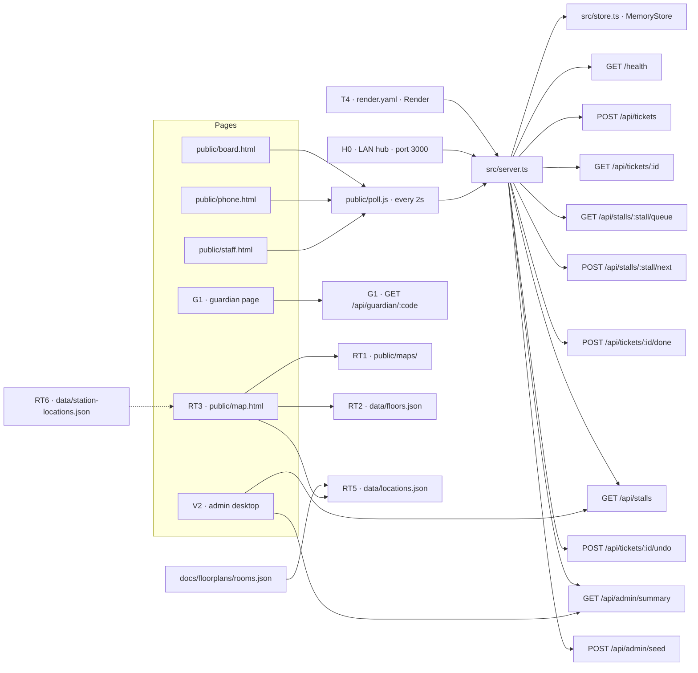

# System

How the running app is wired. A node is either a file or endpoint that exists, or a task id for a page or data file the plans name and the repo does not have yet.

`src/server.ts` serves `public/` as static files and the JSON API. `GET /health` returns `HealthResponse`. Pages that exist today are shells: `public/staff.html`, `public/phone.html`, `public/board.html`. They load `public/poll.js`, which polls every 2 seconds (`ms` defaults to 2000). Nothing in those pages calls `poll` yet.

`getStore()` in `src/store.ts` returns one `MemoryStore` for the process. The LAN hub (`npm run dev`, port 3000 unless `PORT` is set) and the Render service in `render.yaml` are separate processes with separate memory. Render is not connected yet. `healthCheckPath` is `/health` and `SEED` is `"1"`. There is no file persistence (H1).

The dashed line from `data/station-locations.json` is RT9. That task is held until the gym table layout exists. The file itself is RT6, and it maps nothing until then.

`docs/floorplans/rooms.json` is the transcribed labels. `data/floors.json`, `data/locations.json`, and `data/station-locations.json` are not in the repo. The server does not serve a `data/` folder today. RT3 has to make those files reachable on the LAN without changing ticket or stall behavior.

`GuardianStatus` is a type in `src/contract.ts`. `GET /api/guardian/:code` is not in the contract and not in `src/server.ts`. G1 adds the route after L2. `POST /api/admin/seed` is in `src/server.ts` and is not listed in the contract comments.

