# Task graph

Owners, clocks, and dependencies for the queue tasks in `docs/plan.md` and the RT tasks in `docs/plan-room-tba.md`. The run list is `docs/delegation.md`. This is the same graph as the one in that file.

Held tasks (RT9, RT10, RT11) use a dashed border. They have no start time.

`m1100`, `m1230`, and `m1400` are the clock marks. `m1100` is the same event as R2. `m1400` is the same event as S4. `m1230` is the code freeze. RT12 is the map cut at that same minute.

R1, K1, and K2 are real plan.md tasks. Nothing in this pass waits on them. R1 and K1 were the Oct 15 3:00 and 3:30 clocks. The team was still planning when those times passed. K2 is plan.md's Oct 16 3:30 checkpoint. This pass freezes at 12:30 instead.

UP1 is the health pinger from the 4:19 PM note. plan.md has no id for it.

```mermaid
flowchart TD
  classDef held stroke-dasharray: 5 5
  classDef mile fill:#1565c0,color:#fff

  subgraph doneBand ["On main"]
    subgraph doneTroy ["Troy"]
      T1b["T1b · Troy · merge seed fix"]
      F0["F0 · Troy · public shells"]
      T3["T3 · Troy · Store interface"]
      T2["T2 · Troy · ADR 005 and 006"]
    end
  end

  subgraph tonight ["Tonight"]
    subgraph troyN ["Troy"]
      T4["T4 · Troy · connect Render"]
      RT1["RT1 · Troy · clean floor images"]
      RT2["RT2 · Troy · floors file"]
    end
    subgraph donitaN ["Donita"]
      H0["H0 · Donita · hub laptop"]
      D1["D1 · Donita · Call next, Mark done"]
      D3["D3 · Donita · lookup and undo"]
    end
    subgraph justinN ["Justin"]
      J1["J1 · Justin · about 40 tickets"]
      P0["P0 · Justin · poll status text"]
      J2["J2 · Justin · printable ticket"]
    end
    subgraph ayenN ["Ayen"]
      A1["A1 · Ayen · phone ticket and banner"]
      RT6["RT6 · Ayen · empty station file"]
    end
    subgraph vivN ["Viv"]
      V1["V1 · Viv · TV board"]
    end
  end

  subgraph tomorrow ["Tomorrow AM"]
    subgraph troyD ["Troy"]
      L2["L2 · Troy · contract additions"]
      O1["O1 · Troy · wake before demos"]
      O2["O2 · Troy · public URL in README"]
      UP1["UP1 · Troy · health pinger"]
      RT7["RT7 · Troy · map check"]
      X2["X2 · Troy · online guardian test"]
      RT11["RT11 · Troy · library 2F"]
      RT12["RT12 · Troy · map cut"]
      S4["S4 · Troy · submission"]
    end
    subgraph donitaD ["Donita"]
      D2["D2 · Donita · tokens.css"]
      H1["H1 · Donita · hub file"]
      H2["H2 · Donita · offline staff queue"]
      W1["W1 · Donita and Troy · LAN integration"]
      X1["X1 · Donita · offline test"]
      S5["S5 · Donita · backup demo"]
      RT9["RT9 · Donita · gym pins"]
    end
    subgraph justinD ["Justin"]
      RT5["RT5 · Justin · pin labels"]
      G1["G1 · Justin · guardian page"]
      J3["J3 · Justin · QR on ticket"]
    end
    subgraph ayenD ["Ayen"]
      A4["A4 · Ayen · step away and enrolled"]
      A3["A3 · Ayen · pitch and demo script"]
      RT8["RT8 · Ayen · Find your classes"]
      A2["A2 · Ayen · demo check"]
      A5["A5 · Ayen · both modes check"]
      S1["S1 · Ayen · pitch rehearsal"]
      RT10["RT10 · Ayen · alias text"]
    end
    subgraph vivD ["Viv"]
      RT3["RT3 · Viv · map page"]
      RT4["RT4 · Viv · log pin clicks"]
      V3["V3 · Viv · board polish"]
      V2["V2 · Viv · admin desktop"]
      S2["S2 · Viv · README screenshots"]
    end
  end

  subgraph clocks ["Clocks"]
    R2["R2 · all · full dry run"]
    K2["K2 · all · plan said 3:30"]
    m1100["11:00 · all · R2 full dry run"]
    m1230["12:30 · all · code freeze"]
    m1400["2:00 · Troy · S4 submit"]
  end

  subgraph passed ["Day 1 clock passed"]
    R1["R1 · all · dry run"]
    K1["K1 · all · 3:30 checkpoint"]
  end

  F0 --> V1
  F0 --> D1
  F0 --> A1
  F0 --> P0
  T1b --> H0
  T1b --> J1
  T3 --> T4
  T3 --> H1
  T3 --> O1
  D1 --> D3
  D1 --> D2
  A1 --> D2
  V1 --> D2
  V1 --> V3
  V1 --> V2
  A1 --> A4
  J2 --> J3
  P0 --> H2
  L2 --> H2
  L2 --> G1
  H1 --> X1
  H2 --> X1
  T4 --> O1
  O1 --> O2
  T4 --> UP1
  O2 --> X2
  G1 --> X2
  X1 --> A5
  X2 --> A5
  V1 --> W1
  D1 --> W1
  A1 --> W1
  P0 --> W1
  J1 --> W1
  H0 --> W1
  W1 --> A2
  A2 --> R2
  R2 --> m1100
  m1100 --> m1230
  RT1 --> RT2
  RT1 --> RT3
  RT2 --> RT3
  RT3 --> RT4
  RT2 --> RT5
  RT4 --> RT5
  RT2 --> RT7
  RT5 --> RT7
  RT7 --> RT12
  RT3 --> RT8
  A4 --> RT8
  RT8 --> RT12
  RT12 --> m1230
  RT6 --> RT9
  RT3 --> RT9
  RT5 --> RT10
  A3 --> S1
  m1230 --> S1
  m1230 --> S2
  m1230 --> S5
  m1230 --> S4
  S4 --> m1400
  R1 --> K1

  class RT9,RT10,RT11 held
  class m1100,m1230,m1400 mile
```

