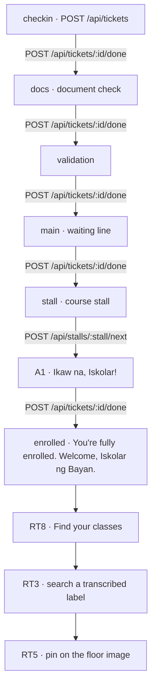

# Freshman journey

The station values are the `Station` union in `src/contract.ts`, in the order in `docs/architecture.md`. Staff advance a ticket with `POST /api/tickets/:id/done`. At the course stall, Call next is `POST /api/stalls/:stall/next`, and the phone banner is the contract string `BRAND.callScreen` (`Ikaw na, Iskolar!`). The enrolled line is `BRAND.enrolledFinal`.

Find your classes is RT8. Search and the pin are RT3 and RT5. Those three are not in the repo yet. If they are not in by the 12:30 cut, the journey stops at the enrolled line and the queue stays.

The phone reads `GET /api/tickets/:id` through `public/poll.js` every 2 seconds once A1 is built. The shells do not call `poll` yet.

