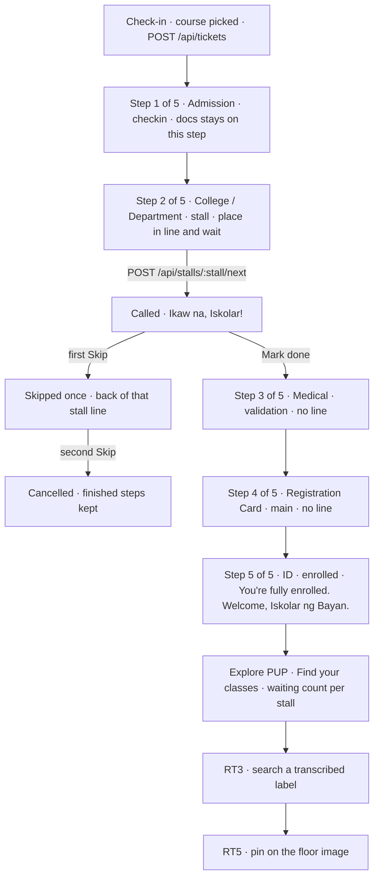

# Freshman journey

The phone shows five steps, "Step N of 5". The station value on each step is the `Station` in [src/contract.ts](../../src/contract.ts). The names and the locks are in [../user-journey.md](../user-journey.md).

The server still advances `checkin` → `docs` → `validation` → `main` → `stall` → `enrolled` with `POST /api/tickets/:id/done`. `docs` is not its own step. While the ticket is at `checkin` or `docs`, the rail shows Step 1. Only Step 2 (`stall`) shows place in line and wait. Course is chosen on `POST /api/tickets`.

Call next at the stall is `POST /api/stalls/:stall/next`. The banner is `BRAND.callScreen` (`Ikaw na, Iskolar!`). The enrolled line is `BRAND.enrolledFinal`. Skip is UJ1 and UJ2: the first Skip sends the ticket to the back of that stall line, the second cancels it, and finished steps stay finished.

Explore PUP is the Room TBA map (RT8, RT3, RT5) plus the number waiting at each stall from `GET /api/stalls`. If the map is not in by the 12:30 cut, the journey stops at the enrolled line and the queue stays.

The arrows from Step 1 through Step 5 are the rail the student reads. They are not a change to the server's station order. Steps 3 and 4 can be reached before Step 2, because `validation` and `main` still come before `stall`.
