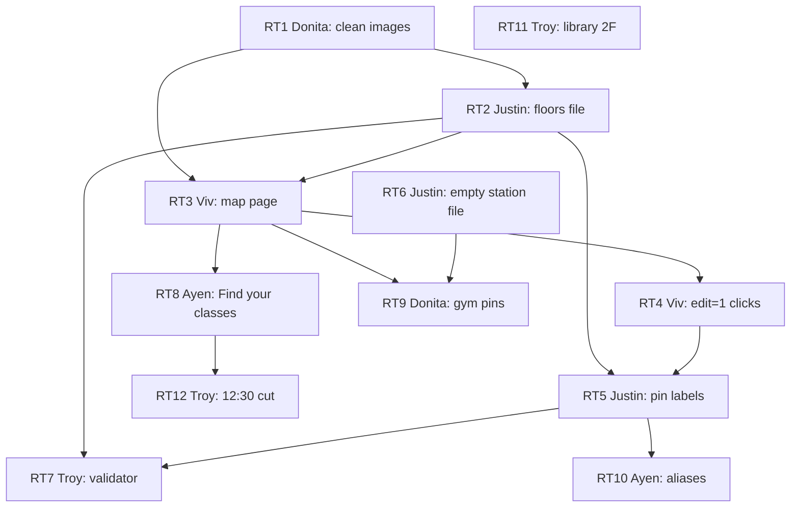

# Room TBA plan

Tasks for campus wayfinding inside IsQolar. The source is [floorplans/ROOM-TBA-PLAN.md](floorplans/ROOM-TBA-PLAN.md). That file has the floors, the data files, and the cut. This file numbers the work RT1 and up so each task can be one PR.

Owners are the roles already listed in [plan.md](plan.md):

| Person | Role used here |
|---|---|
| Troy | Project manager. Shared check script, the cut, and holds that need a team decision. |
| Donita | Images and the gym, which is the enrollment venue. |
| Ayen | Student phone, and the names students actually use. |
| Viv | The map page, a new public screen. |
| Justin | The JSON files the map reads. |

Rule from the source plan: one task per branch, `npm run check` before the PR, CI `check` must pass. Do not edit [src/contract.ts](../src/contract.ts).

## Tasks

| ID | Owner | Task | Needs | Band | Done when |
|---|---|---|---|---|---|
| RT1 | Donita | Clean the tonight floor images | none | Tonight | `public/maps/` has a cleaned image for the Main ground lobby from `IBM_7739`, a straightened and cropped Main 4F image from `IBM_7741`, and a Main 5F image from `IBM_7742`. |
| RT2 | Justin | Write the floors file | RT1 | Tonight | `data/floors.json` lists those three floors with `id`, `building`, `floor`, `label`, `image`, and `approximate`. The lobby row has `approximate: true`. Image fields point at the RT1 files. |
| RT3 | Viv | Add the map page | RT1, RT2 | Tonight | `public/map.html` and `public/map.js` have a floor switcher, the floor image with an SVG pin overlay, a search box that finds a row by its label, a detail card, and deep links `map.html?loc=<id>` and `map.html?floor=<id>`. Usable at 360 px. |
| RT4 | Viv | Log pin clicks | RT3 | Tonight | `map.html?edit=1` logs a clicked `x,y` on a 0 to 1 scale to the console. There is no editor UI. |
| RT5 | Justin | Pin transcribed labels for floors 1 to 3 | RT2, RT4 | Tonight | `data/locations.json` has one row per [rooms.json](floorplans/rooms.json) label on Main 1F (`IBM_7739`, 27 labels), Main 4F (`IBM_7741`, 39), and Main 5F (`IBM_7742`, 76). Each row has `id`, `floorId`, `label`, `kind`, `x`, `y`, `aliases` as an empty array, `source`, and `verified`. `x` and `y` are inside 0..1 and come from edit clicks. Labels that contain `?` stay unverified. |
| RT6 | Justin | Add an empty station link file | none | Tonight | `data/station-locations.json` exists and maps no station or stall id. |
| RT7 | Troy | Check map data in `npm run check` | RT2, RT5 | Tonight | `npm run check` fails on a duplicate id, an unknown `floorId`, an `x` or `y` outside 0..1, an unknown `kind`, or a missing image file. It prints the count of `verified: false` rows and the count of labels that contain `?`. |
| RT8 | Ayen | Link Find your classes | RT3 | Tonight | On the fully enrolled phone screen, a link reads "Find your classes" and opens `map.html`. The queue pages still run if that link is removed. |
| RT9 | Donita | Gym pins and station links | RT3, RT6 | Held | Gym pins stay absent, and `data/station-locations.json` stays empty, until the team supplies the gym table layout. After that, pins from `IBM_7734` go in, and the file maps station and stall ids to those location ids. "Show on map" appears for the current station only where a link exists. |
| RT10 | Ayen | Alias text | RT5 | Held | Every `aliases` array stays empty until the team supplies at least five real other names. Only those supplied names are added. Search may use an alias only after it is on the row. |
| RT11 | Troy | Library 2F | none | Held | `IBM_7721` stays out of `data/floors.json` and `public/maps/` until the team confirms that image is the library. If it is confirmed, use the `rooms.json` labels for that image and no others. The building and floor in that file are marked `?`. |
| RT12 | Troy | 12:30 cut | RT8 | Cut | At 12:30 PM on Oct 16, either RT1 through RT8 are merged and a search on a tonight floor lands on a pin, or the map link and the map files are removed and the queue is unchanged. |

Tonight means floors 1 to 3 only: Main lobby (`IBM_7739`), Main 4F (`IBM_7741`), Main 5F (`IBM_7742`), pins for labels already transcribed. Library 3F and the campus overview are not tonight work. `IBM_7740` and `IBM_7726` are extras and are not in `rooms.json`.

The two-day schedule in [plan.md](plan.md) still places submission tasks S1 to S5 in the 3:30 to 5:00 band on Oct 16. The map cut is earlier: 12:30 PM.

## Dependency graph



RT6 and RT11 have no upstream task. RT11 waits on a confirmation, not on code.

## Held, tonight, and cut

**Tonight (RT1 to RT8).** Clean images, floors file, map page, click logging, pins for transcribed labels on floors 1 to 3, an empty station file, the validator, and the Find your classes link.

**Held.**

- RT9. Gym pins and station links. Blocked on the gym table layout. `IBM_7734` is the gym photo. It is not a table layout.
- RT10. Alias search text. Blocked on at least five real other names from the team. The repo has no alias examples.
- RT11. Library 2F. Blocked on confirmation that `IBM_7721` is the library. The catalog titles it PUP ICT Office 2F.

**Cut (RT12).** 12:30 PM on Oct 16. If the tonight tasks are not in and a search does not land on a pin, remove the map link and the map files. The queue is untouched. Ask PUP before a merge that would publish floor plan images on the public Render URL. See [decisions/007-room-tba-2d.md](decisions/007-room-tba-2d.md).

## Prompts

Paste one prompt per task. Fill nothing in. The paths below match this repo.

### RT1 Donita

```
Read docs/plan-room-tba.md task RT1, docs/floorplans/ROOM-TBA-PLAN.md, and docs/map-data-guide.md.
Branch from fresh main: donita/rt1-clean-floors.
Copy and clean only these three sources from docs/floorplans/ into public/maps/: IBM_7739.JPG (Main ground lobby stand-in), IBM_7741.JPG (straighten and crop), IBM_7742.JPG (already a good straight-on plan).
Do not add IBM_7721, IBM_7734, IBM_7740, IBM_7726, the glare skips, or library-3F.png.
Do not edit src/contract.ts. Do not invent rooms or coordinates.
When the images are in public/maps/, run npm run check, open a PR.
```

### RT2 Justin

```
Read docs/plan-room-tba.md task RT2 and docs/map-data-guide.md.
Branch from fresh main: justin/rt2-floors-json.
Add data/floors.json with the three tonight floors only. Fields: id, building, floor, label, image, approximate.
The IBM_7739 lobby row has approximate true. Image fields point at the RT1 files in public/maps/.
Copy building and floor text from docs/floorplans/rooms.json. Do not invent a floor.
Do not edit src/contract.ts.
When done, run npm run check, open a PR.
```

### RT3 Viv

```
Read docs/plan-room-tba.md task RT3, docs/floorplans/ROOM-TBA-PLAN.md, and docs/product.md.
Branch from fresh main: viv/rt3-map-page.
Add public/map.html and public/map.js: floor switcher, floor image, SVG pin overlay, search by label, detail card, deep links map.html?loc=<id> and map.html?floor=<id>.
Read floors and locations from data/floors.json and data/locations.json. Insert text without unsanitized innerHTML. The page must be usable at 360 px and must work on the LAN with no CDN.
Do not edit src/contract.ts. Do not add a room that is not in the JSON.
When done, run npm run check, open the page on a phone-width window, open a PR.
```

### RT4 Viv

```
Read docs/plan-room-tba.md task RT4 and docs/map-data-guide.md.
Branch from fresh main: viv/rt4-edit-pins.
On public/map.html?edit=1, a click on the floor image logs x and y to the console, each between 0 and 1, relative to the image.
Do not build an editor UI. Do not write the click to disk.
Do not edit src/contract.ts.
When done, run npm run check, click once and confirm the console line, open a PR.
```

### RT5 Justin

```
Read docs/plan-room-tba.md task RT5 and docs/map-data-guide.md.
Branch from fresh main: justin/rt5-location-pins.
Write data/locations.json with one row for every rooms.json label whose source is IBM_7739, IBM_7741, or IBM_7742.
Fields: id, floorId, label, kind, x, y, aliases (empty array), source, verified.
Copy label, kind, and source from docs/floorplans/rooms.json. Keep every "?".
Set x and y only from map.html?edit=1 console logs, each inside 0..1. Leave verified false when the label contains "?".
Do not add aliases. Do not edit src/contract.ts. Do not add a label that is not in rooms.json.
When done, run npm run check, open a PR.
```

### RT6 Justin

```
Read docs/plan-room-tba.md task RT6 and docs/floorplans/ROOM-TBA-PLAN.md.
Branch from fresh main: justin/rt6-station-locations.
Add data/station-locations.json as an empty mapping from station or stall id to location id. No gym rows.
Do not edit src/contract.ts. Do not invent a table layout.
When done, run npm run check, open a PR.
```

### RT7 Troy

```
Read docs/plan-room-tba.md task RT7 and docs/map-data-guide.md.
Branch from fresh main: troy/rt7-map-validator.
Include a map-data check in npm run check. Fail on a duplicate id, an unknown floorId, an x or y outside 0..1, an unknown kind, or a missing image file.
Print the count of verified false rows and the count of labels that contain "?".
Known kinds are room, office, cr, stairs, exit, elevator, assembly, other.
Do not edit src/contract.ts. Do not change queue logic.
When done, run npm run check, open a PR.
```

### RT8 Ayen

```
Read docs/plan-room-tba.md task RT8 and docs/product.md.
Branch from fresh main: ayen/rt8-find-your-classes.
On the phone's fully enrolled screen, add a link whose text is "Find your classes" and whose target is map.html.
The enrolled sentence stays the contract string: "You're fully enrolled. Welcome, Iskolar ng Bayan."
The queue pages must still load if that link and the map files are removed.
Do not edit src/contract.ts.
When done, run npm run check, open the enrolled screen and follow the link, open a PR.
```

### RT9 Donita

```
Read docs/plan-room-tba.md task RT9.
Do not start this branch until the team has supplied the gym table layout. IBM_7734 is the gym floor photo, not that layout.
When the layout exists: branch donita/rt9-gym-pins. Add pins for the IBM_7734 labels in docs/floorplans/rooms.json, and fill data/station-locations.json with the station and stall ids the layout names.
Add "Show on map" on the phone only for a station that has a link.
Keep "?" labels unverified. Do not edit src/contract.ts. Do not invent tables or coordinates.
When done, run npm run check, open a PR.
```

### RT10 Ayen

```
Read docs/plan-room-tba.md task RT10 and docs/map-data-guide.md.
Do not start until the team has written down at least five real other names for rooms that are already in data/locations.json.
Branch ayen/rt10-aliases. Append only those supplied strings to the aliases arrays. Do not invent a name. Do not edit src/contract.ts.
When done, run npm run check, search for one supplied alias, open a PR.
```

### RT11 Troy

```
Read docs/plan-room-tba.md task RT11, docs/floorplans/catalog.md, and the IBM_7721 rows in docs/floorplans/rooms.json.
Do not add IBM_7721 to data/floors.json or public/maps/ unless the team confirms that photo is the library.
The building and floor on those rows are marked "?". Keep them.
If confirmed, branch troy/rt11-library-2f and add only the rooms.json labels for source IBM_7721.
Do not edit src/contract.ts.
When done, run npm run check, open a PR.
```

### RT12 Troy

```
Read docs/plan-room-tba.md task RT12.
At 12:30 PM on Oct 16, check whether RT1 through RT8 are merged and a search on a tonight floor lands on a pin.
If yes, leave the Find your classes link.
If no, remove the map link and the map files. Do not change queue logic. Do not edit src/contract.ts.
Branch troy/rt12-map-cut only when removing the map. Run npm run check, open a PR.
```
