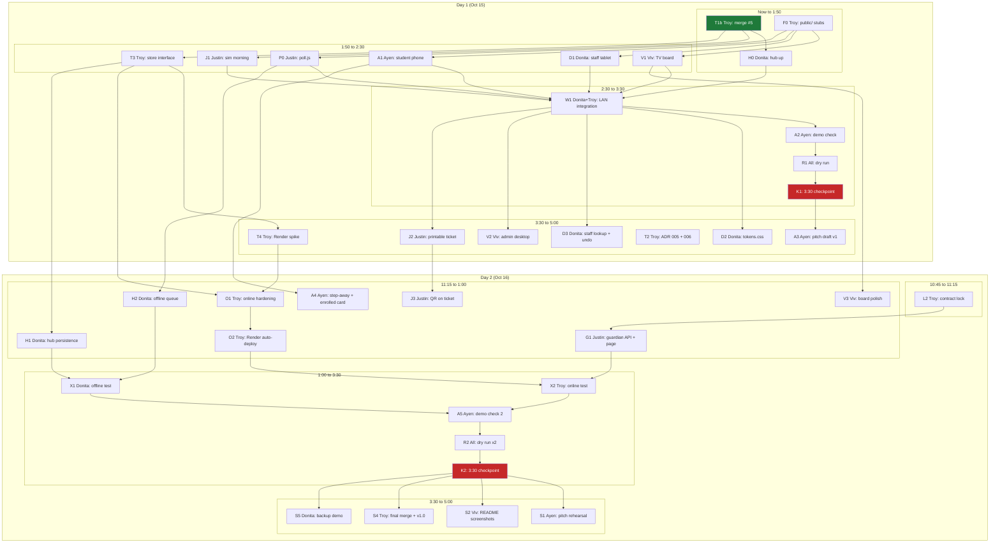

# IsQolar plan v3: two days (Oct 15 to 16)

This file is temporary. Delete it after the Bobathon.

Both days follow the same schedule: start about 10:45, 3:30 checkpoint, wrap-up about 5:00 (Asia/Manila).
**Day 1 goal:** the three-screen loop works on the LAN by 3:30.
**Day 2 goal:** the same loop works online too, plus the trust features, then a polished demo and submission.

Room TBA tasks (find a room on the same phone) are in [plan-room-tba.md](plan-room-tba.md). The one-product story is in [product.md](product.md). If the map is not solid by 12:30 PM on Oct 16, remove the map link and the map files. The queue stays. Photos and labels are in [floorplans/](floorplans/).

The run list for the night of Oct 15 and the morning of Oct 16 is [delegation.md](delegation.md). Where a clock or an RT owner differs, delegation.md wins.

---

## Owners

| Person | Role | Owns |
|---|---|---|
| Troy | Project manager, full stack | Contract, merges, online: Render deploy |
| Donita | Full stack | Hub: laptop server, offline-first, persistence, offline staff queue, design tokens |
| Ayen | Product manager, front end | Student phone (join, ticket, call banner), demo script, checks |
| Viv | Front end | TV board, admin desktop |
| Justin | Back end | Simulated morning, poll client, printable ticket + QR, guardian API |

Rule: work starts from a fresh main, one task per PR, `npm run check` before every PR, auto-merge on.

---

## Day 1 (today, Oct 15)

### Now to 1:50 — unblock

| ID | Owner | Task | Needs | Done when |
|---|---|---|---|---|
| T1b | Troy | Merge #5 (seed fix), diff server/store against main, check passes | — | #5 merged |
| F0 | Troy | `public/` with three empty pages (board, staff, ticket) + js stubs | — | merged |
| H0 | Donita | Take over the hub: run `npm run dev` on the hub laptop, phone opens `http://<ip>:3000/health`. If blocked, switch to a phone hotspot | T1b | phone shows `ok` |

### 1:50 to 2:30 — build the loop (parallel)

| ID | Owner | Task | Needs | Done when |
|---|---|---|---|---|
| V1 | Viv | TV board: stalls grouped by department, Now serving, queue length, estimated wait | F0 | renders seeded stalls |
| D1 | Donita | Staff tablet `/staff.html?stall=`: Call next, Mark done | F0 | calling updates the board |
| A1 | Ayen | Student phone: join form, ticket with code, position, wait, plus the "Ikaw na, Iskolar!" banner when called | F0 | banner shows within 2 s of Call next |
| P0 | Justin | `public/js/poll.js`: poll every 2 s, "last updated" time, "offline, retrying" label | F0 | used by all three pages |
| J1 | Justin | Simulated morning: real PUP departments, about 40 tickets, uneven waits, reseeds in under 10 s | T1b | board looks busy |
| T3 | Troy | `store.ts` behind an interface (get/set ticket, stall), so an online store can be swapped in tomorrow. No behavior change | T1b | tests still pass |

### 2:30 to 3:30 — integrate and checkpoint

| ID | Owner | Task | Needs | By |
|---|---|---|---|---|
| W1 | Donita + Troy | Integration on three real devices on the hub LAN (hard start 2:30) | V1 D1 A1 P0 J1 H0 | 2:45 |
| A2 | Ayen | Demo check against the script, including "staff tap Call next live" | W1 | 2:50 |
| R1 | All | Dry run, with one reseed rehearsed | A2 | 3:00 |
| K1 | — | **3:30 checkpoint (hard)** | R1 | 3:30 |

> Fallback: if 2:50 isn't green, demo all three screens on one laptop.

### 3:30 to 5:00 — harden and prep day 2

| ID | Owner | Task | Needs |
|---|---|---|---|
| D2 | Donita | `tokens.css` + LiveStatus applied across the three pages | W1 |
| D3 | Donita | Staff lookup by ticket code + Undo button | W1 |
| V2 | Viv | Admin desktop: counts per station, slowest stall | W1 |
| J2 | Justin | Printable ticket page (print CSS), code + course | W1 |
| T2 | Troy | Docs: ADR 006 store interface, README/AGENTS wording (ADR 005 Render is done) | — |
| T4 | Troy | Render spike: connect the repo, deploy main as is, open the public URL and run one ticket through | T3 |
| A3 | Ayen | Pitch draft v1 + day 2 demo script with online and offline beats | K1 |

---

## Day 2 (tomorrow, Oct 16)

### 10:45 to 11:15 — lock

| ID | Owner | Task |
|---|---|---|
| L2 | Troy | Contract additions frozen: GuardianStatus endpoint, `source: "hub" \| "online"`, sync fields for the staff queue |

### 11:15 to 1:00 — two modes + trust features (parallel)

| ID | Owner | Task | Needs |
|---|---|---|---|
| O1 | Troy | Online hardening: health check, seed on deploy with `SEED=1`, wake the instance before demos | T4 |
| O2 | Troy | Render auto-deploy from main, public URL shared in README and on the printed ticket | O1 |
| H1 | Donita | Hub persistence: snapshot state to a JSON file every change, reload on start | T3 |
| H2 | Donita | Offline staff queue: Call next / Mark done saved locally while offline, replayed when the hub returns, "synced later" mark (same pattern as Tapat) | P0 |
| G1 | Justin | Guardian API `GET /api/guardian/:code` read-only + page | L2 |
| J3 | Justin | QR on the printed ticket that opens the student page | J2 |
| A4 | Ayen | Student page: "you can step away" hint when the wait is over 20 min, final "You're fully enrolled" card | A1 |
| V3 | Viv | Board polish for TV at 1920×1080 + department colours + simulated-morning label | V1 |

### 1:00 to 3:30 — prove both modes

| ID | Owner | Task | Needs | By |
|---|---|---|---|---|
| X1 | Donita | Offline test: unplug the router mid-demo, staff keep working, sync on reconnect | H1 H2 | 2:00 |
| X2 | Troy | Online test: guardian on mobile data opens the Render URL | O2 G1 | 2:00 |
| A5 | Ayen | Demo check 2, both modes | X1 X2 | 2:30 |
| R2 | All | Full dry run ×2 with timing | A5 | 3:15 |
| K2 | — | **3:30 checkpoint (hard)** | R2 | 3:30 |

### 3:30 to 5:00 — ship

| ID | Owner | Task |
|---|---|---|
| S1 | Ayen | Final pitch rehearsed twice |
| S2 | Viv | README screenshots for each viewport |
| S4 | Troy | Final merge, tag v1.0, submission |
| S5 | Donita | Backup demo: hub laptop + hotspot ready |

---

## Later (if this goes real)

PUP permission (name, colours, seal), registrar confirms stations, O1 slots left per course (needs the team's answer), SMS for guardians.

---

## Dependency graph

