# IsQolar plan v3: two days (Oct 15 to 16)

This file is temporary. Delete it after the Bobathon.

Clocks as of the night of Oct 15 (Asia/Manila): tonight each person pushes a PR before sleeping. Oct 16 is a full dry run at 11:00 AM, code freeze at 12:30 PM (also the Room TBA cut), and submit at 2:00 PM.
**Tonight:** board, staff, and phone are in PRs, with the hub, the seed, and the Render connect.
**Oct 16:** prove that loop at 11:00, land the trust features before 12:30, submit at 2:00.

R1 (3:00 dry run) and K1 (3:30 checkpoint) are not start-now tasks. The team was still planning when those clocks passed. K2 is not the freeze.

Room TBA tasks (find a room on the same phone) are in [plan-room-tba.md](plan-room-tba.md). The one-product story is in [product.md](product.md). If the map is not solid by 12:30 PM on Oct 16, remove the map link and the map files. The queue stays. Photos and labels are in [floorplans/](floorplans/).

Paste-ready prompts are in [delegation.md](delegation.md). This file is the task list those prompts follow.

---

## Owners

| Person | Role | Owns |
|---|---|---|
| Troy | Project manager, full stack | Contract, merges, online: Render deploy |
| Donita | Full stack | Hub: laptop server, offline-first, persistence, offline staff queue, design tokens |
| Ayen | Product manager, front end | Student phone (join, ticket, call banner), demo script, checks |
| Viv | Front end | TV board, admin desktop |
| Justin | Back end | Simulated morning, poll client, printable ticket + QR, guardian API |

Rule: work starts from a fresh main, one task per PR, `npm run check` before every PR, auto-merge on.

---

## On main

| ID | Owner | Task | Needs | Done when |
|---|---|---|---|---|
| T1b | Troy | Merge #5 (seed fix), diff server/store against main, check passes | none | #5 merged |
| F0 | Troy | `public/` shells: `board.html`, `staff.html`, `phone.html`, `poll.js` | none | merged |
| T3 | Troy | `store.ts` behind a Store interface. No behavior change | T1b | tests still pass |
| T2 | Troy | ADR 006, and README/AGENTS wording for ADR 005 | none | merged |

## Tonight (Oct 15, before sleep)

| ID | Owner | Task | Needs | Done when |
|---|---|---|---|---|
| H0 | Donita | Hub laptop: `npm run dev`. Phone opens `http://<ip>:3000/health`. If blocked, switch to a phone hotspot | T1b | phone shows `ok` |
| D1 | Donita | Staff tablet `/staff.html?stall=`: Call next, Mark done | F0 | calling updates the board |
| D3 | Donita | Staff lookup by ticket code, plus Undo. Match the code on `GET /api/stalls/:stall/queue`. `GET /api/tickets/:id` is the ticket id, not the printed code. Do not add a route | D1 | Undo restores the previous ticket |
| V1 | Viv | TV board: stalls grouped by department, Now serving, queue length, estimated wait | F0 | renders seeded stalls |
| A1 | Ayen | Student phone: join form, ticket with code, position, wait, plus the "Ikaw na, Iskolar!" banner when called | F0 | banner shows within 2 s of Call next |
| P0 | Justin | `public/poll.js`: last-updated time and offline state. `public/js/poll.js` does not exist | F0 | the poller sets that state. The three pages read it |
| J1 | Justin | About 40 simulated tickets on stalls `BSCS-1`, `BSIT-1`, and `BSEE-1`, with uneven queue lengths. Keep `simulated` true | T1b | board looks busy |
| J2 | Justin | Printable ticket (print CSS), code and course. No CDN | none | a printed ticket shows code and course |
| T4 | Troy | Render: connect the Blueprint, deploy main, open the public URL. Do not guess the hostname | T3 | public `GET /health` returns `{"ok":true}` |

Room TBA tonight, in [plan-room-tba.md](plan-room-tba.md): RT1 Viv (clean the three floor images), RT2 Troy (floors file, after RT1), RT6 Ayen (empty station file).

## Tomorrow morning, before 11:00

| ID | Owner | Task | Needs | Done when |
|---|---|---|---|---|
| L2 | Troy | Contract additions: `GET /api/guardian/:code` returning `GuardianStatus`, `source: "hub" \| "online"`, and the staff-queue sync fields. Only Troy edits `src/contract.ts` | none | those shapes are in the contract, and the PR tells the team |
| D2 | Donita | `public/tokens.css` plus LiveStatus on the three pages | D1 A1 V1 | each page loads the file and shows a last-updated line |
| H1 | Donita | Hub persistence: snapshot state to a JSON file every change, reload on start. Render stays in memory | T3 | a hub restart restores the tickets |
| A4 | Ayen | Step-away hint when the wait is over 20 min, and the enrolled card | A1 | the enrolled line is the contract string |
| A3 | Ayen | Pitch draft and a demo script with a LAN beat and a Render beat | none | the doc uses the contract pitch line and does not claim Render is live |
| V3 | Viv | Board polish for 1920×1080, department colours from the design tokens, simulated-morning label | V1 | the board is drawn for that size and seeded tickets read as simulated |
| V2 | Viv | Admin desktop: counts per station, slowest stall. Counts from `GET /api/admin/summary`. Slowest stall from `GET /api/stalls` `queueLength`. Do not add a contract field | V1 | the page shows both |

## 11:00 dry run

| ID | Owner | Task | Needs | Done when |
|---|---|---|---|---|
| W1 | Donita and Troy | Three devices on the hub LAN | V1 D1 A1 P0 J1 H0 | Call next updates the phone and the board within 2 s |
| A2 | Ayen | Demo check, including staff tap Call next live | W1 | the banner appears within 2 s |
| R2 | All | Full dry run. Troy runs the clock | W1 A2 | the loop above passes at 11:00 |

Fallback: if the three devices are not green, demo all three screens on one laptop.

## Before the 12:30 freeze

| ID | Owner | Task | Needs | Done when |
|---|---|---|---|---|
| O1 | Troy | Wake the free Render instance before demos. Health check and `SEED=1` are already in `render.yaml` | T4 | README says to open the real public URL before a demo |
| O2 | Troy | Put that URL in README. `autoDeploy` is already true. The printed ticket is J3, not this task | O1 | README has the real URL and no guessed host |
| UP1 | Troy | Health pinger: a scheduled GitHub Actions GET of the public `/health`. Not an outbound call from the app. No guessed host | T4 | the workflow hits the real URL. Skip the PR if T4 has no URL |
| H2 | Donita | Offline staff queue: Call next and Mark done saved locally, replayed when the hub returns, synced-later mark (same pattern as Tapat) | P0 L2 | replay works, using only the sync fields L2 added |
| G1 | Justin | Guardian API `GET /api/guardian/:code` plus `public/guardian.html`. Do not edit the contract | L2 | the route returns the `GuardianStatus` shape from L2 |
| J3 | Justin | QR on the printed ticket that opens the student page. Relative URL. No CDN | J2 | the QR opens the phone page on the hub |
| X1 | Donita | Offline test: unplug the router, staff keep working, sync on reconnect | H1 H2 | the hub matches the tablet after reconnect |
| X2 | Troy | Online test: guardian on mobile data opens the Render URL | O2 G1 | the public guardian URL returns the payload |
| A5 | Ayen | Demo check for LAN and Render | X1 X2 | both beats pass, or the gap is recorded. This does not block the freeze |

Room TBA before the cut: RT3 and RT4 (Viv), RT5 (Justin), RT7 (Troy), RT8 (Ayen, after A4 and RT3). RT12 (Troy) is the 12:30 map cut.

## After 12:30, submit at 2:00

No product code after the freeze.

| ID | Owner | Task | Needs | Done when |
|---|---|---|---|---|
| S1 | Ayen | Final pitch rehearsed twice | A3 | rehearsed twice before 2:00 |
| S2 | Viv | README screenshots for the phone, staff, and board | V1 D1 A1 | README links a shot of each |
| S5 | Donita | Backup demo: hub laptop plus hotspot | none | a phone can open `/health` on the hotspot |
| S4 | Troy | Final merge, tag v1.0, submission | the freeze | submitted at 2:00 |

---

## Later (if this goes real)

PUP permission (name, colours, seal), registrar confirms stations, O1 slots left per course (needs the team's answer), SMS for guardians.

---

## Dependency graph

Room TBA tasks are on this same picture in [diagrams/task-graph.md](diagrams/task-graph.md). R1, K1, and K2 are not on this path.

```mermaid
flowchart TD
  classDef done fill:#1f7a3a,color:#fff
  classDef mile fill:#1565c0,color:#fff

  subgraph OnMain["On main"]
    T1b["T1b Troy: merge #5"]
    F0["F0 Troy: public shells"]
    T3["T3 Troy: Store interface"]
    T2["T2 Troy: ADR 005 and 006"]
  end

  subgraph Tonight["Tonight"]
    H0["H0 Donita: hub"]
    D1["D1 Donita: Call next"]
    D3["D3 Donita: undo"]
    V1["V1 Viv: TV board"]
    A1["A1 Ayen: phone"]
    P0["P0 Justin: poll status"]
    J1["J1 Justin: about 40 tickets"]
    J2["J2 Justin: printable ticket"]
    T4["T4 Troy: connect Render"]
  end

  subgraph Morning["Before 11:00"]
    L2["L2 Troy: contract"]
    D2["D2 Donita: tokens"]
    H1["H1 Donita: hub file"]
    A4["A4 Ayen: enrolled card"]
    A3["A3 Ayen: pitch"]
    V3["V3 Viv: board polish"]
    V2["V2 Viv: admin"]
  end

  subgraph Dry["11:00"]
    W1["W1 Donita and Troy: LAN"]
    A2["A2 Ayen: demo check"]
    R2["R2 all: dry run"]
  end

  subgraph Freeze["Before 12:30"]
    O1["O1 Troy: wake note"]
    O2["O2 Troy: URL in README"]
    UP1["UP1 Troy: health pinger"]
    H2["H2 Donita: offline queue"]
    G1["G1 Justin: guardian"]
    J3["J3 Justin: QR"]
    X1["X1 Donita: offline test"]
    X2["X2 Troy: online test"]
    A5["A5 Ayen: both modes"]
  end

  subgraph Ship["After 12:30"]
    S1["S1 Ayen: pitch rehearsal"]
    S2["S2 Viv: screenshots"]
    S5["S5 Donita: hotspot"]
    S4["S4 Troy: 2:00 submit"]
  end

  T1b --> H0
  T1b --> J1
  T3 --> T4
  T3 --> H1
  T3 --> O1
  F0 --> V1
  F0 --> D1
  F0 --> A1
  F0 --> P0
  D1 --> D3
  D1 --> D2
  A1 --> D2
  V1 --> D2
  V1 --> V3
  V1 --> V2
  A1 --> A4
  V1 --> W1
  D1 --> W1
  A1 --> W1
  P0 --> W1
  J1 --> W1
  H0 --> W1
  W1 --> A2
  A2 --> R2
  J2 --> J3
  P0 --> H2
  L2 --> H2
  L2 --> G1
  T4 --> O1
  O1 --> O2
  T4 --> UP1
  O2 --> X2
  G1 --> X2
  H1 --> X1
  H2 --> X1
  X1 --> A5
  X2 --> A5
  A3 --> S1
  R2 --> S4

  class T1b,F0,T3,T2 done
  class R2,S4 mile
```

